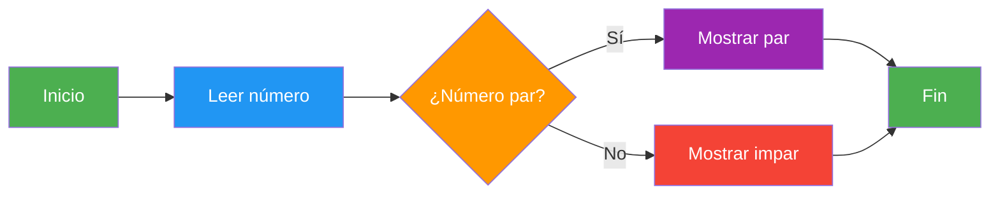
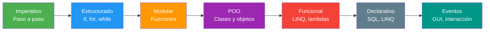
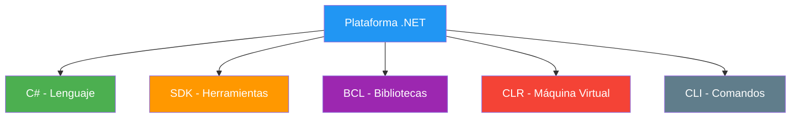

<div class="flex items-center gap-4 w-full">
  
  <span class="ud-pill">Programación · 1DAW · Curso 2026-2027</span>
</div>

# Introducción a la Programación Software

### Del algoritmo en papel a tu primer programa en C#

<div class="mt-10 flex items-end justify-between w-full">
  <div class="text-left">
    <b class="text-lg">José Luis González Sánchez</b><br/>
    <span class="opacity-70">IES Luis Vives · Leganés · <a href="https://joseluisgs.dev">joseluisgs.dev</a></span>
  </div>
  <PacMan :size="54" label="Cargando ideas..." />
</div>

---

## 📦 Materiales de la unidad

Todo el material de la UD01 está publicado en el repositorio de GitHub, organizado por carpetas:

<div class="grid grid-cols-2 gap-6 items-start">
<div>

- 📚 **11 puntos** — teoría, ejemplos reales y resúmenes
- 📝 **Prácticas** — ejercicios graduados en `practicas/`
- 💻 **Soluciones** — proyectos C# con `.slnx` en `Soluciones/`
- 🖼️ **Imágenes y recursos** — diagramas y esquemas en `images/`
- 🎬 **Vídeos** — lista de reproducción en YouTube

</div>
<div class="flex flex-col items-center justify-center gap-4 pt-4">

<RepoBadge caption="Repositorio con materiales de la unidad" size="lg" />

<div class="text-sm opacity-75 text-center max-w-55">

Clónalo, forquéalo o descárgalo en zip: el material siempre está a un clic.

</div>

</div>
</div>

---

## 📚 Índice: los 11 puntos del tema

<div class="grid grid-cols-3 gap-3 text-sm">

<TopicCard :num="1" title="Qué es la programación" desc="Algoritmos, paradigmas y lenguajes" />
<TopicCard :num="2" title="El entorno .NET" desc="SDK, CLI, NuGet e IDE" />
<TopicCard :num="3" title="Soluciones y proyectos" desc=".slnx, .csproj y compilación" />
<TopicCard :num="4" title="Estructura de un programa" desc="Bloques, sentencias y TLP" />
<TopicCard :num="5" title="Tipos de datos" desc="Enteros, texto, lógicos y más" />
<TopicCard :num="6" title="Variables, constantes y literales" desc="Declaración y buenas prácticas" />
<TopicCard :num="7" title="Operadores y expresiones" desc="Aritméticos, lógicos y precedencia" />
<TopicCard :num="8" title="Conversiones de tipo" desc="Implícitas y explícitas" />
<TopicCard :num="9" title="Entrada y salida de datos" desc="Console.ReadLine y WriteLine" />
<TopicCard :num="10" title="Comentarios y documentación" desc="Buenas prácticas de código" />
<TopicCard :num="11" title="Resumen y conclusiones" desc="Cierre de la unidad" />

</div>

<div class="ud-card mt-4 flex items-center justify-between gap-4 px-4 py-2">

<span class="text-sm">📦 <b>Materiales:</b> los 11 puntos, prácticas, soluciones y vídeos de la unidad</span>

<RepoBadge />

</div>

<!--
Pon en el mapa el recorrido completo aunque hoy solo veamos los 3 primeros puntos.
-->

---

## 🎯 Resultados de aprendizaje y criterios

<RaaCcee
  code="RA1"
  title="Reconoce la estructura de un programa informático, identificando y relacionando los elementos propios del lenguaje de programación utilizado."
  :ccee="[
    'Se han identificado los bloques que componen la estructura de un programa informático.',
    'Se han creado proyectos de desarrollo de aplicaciones.',
    'Se han utilizado entornos integrados de desarrollo.',
    'Se han identificado los distintos tipos de variables y la utilidad específica de cada uno.',
    'Se ha modificado el código de un programa para crear y utilizar variables.',
    'Se han creado y utilizado constantes y literales.',
    'Se han clasificado, reconocido y utilizado en expresiones los operadores del lenguaje.',
    'Se ha comprobado el funcionamiento de las conversiones de tipo explícitas e implícitas.',
    'Se han introducido comentarios en el código.',
  ]"
/>

---
layout: section
---

<div class="ud-section-number">01</div>

# Qué es la programación

<div class="opacity-70">Punto 1 del tema · Algoritmos, paradigmas y lenguajes</div>

---

## 1 · Punto de partida

<div class="grid grid-cols-2 gap-6 items-start">
<div>

<TipBox type="consejo" title="Punto de partida">

¿Alguna vez has pensado **cómo funciona Netflix** cuando te recomienda una serie, o **cómo Instagram** decide qué posts ves primero? Todo eso es programación. Pero, ¿qué es exactamente programar?

</TipBox>

<TipBox type="analogia">

**Programar es como montar un restaurante:** necesitas ingredientes (datos), una receta (algoritmo), utensilios (operadores) y saber qué pide el cliente (entrada). Si falta alguno, el plato no sale bien.

</TipBox>

</div>
<div>

<Objetivos
  :items="[
    'Definir qué es la programación y por qué es importante',
    'Comprender qué es un algoritmo, sus características y cómo se representa',
    'Conocer los principales paradigmas de programación',
    'Entender por qué C# es el lenguaje que usaremos',
  ]"
/>

</div>
</div>

---

## 🍳 Si programáramos como cocináramos

<div class="text-sm opacity-75 mb-3">Cada concepto de programación tiene su equivalente en la cocina:</div>

<CookingMap />

---

## ¿Qué es programar?

<div class="grid grid-cols-2 gap-5 items-start">
<div>

- **Programar**: escribir instrucciones que un ordenador pueda entender y ejecutar para resolver un problema.
- **Programa**: conjunto de instrucciones escritas en un lenguaje de programación.
- **Algoritmo**: secuencia ordenada de pasos para resolver un problema. El "plan" **antes** de programar.

<TipBox type="nota">

Un ordenador es **muy literal**: no admite ambigüedades. Por eso el algoritmo debe estar bien definido.

</TipBox>

</div>
<div>

<WindowFrame file="Program.cs">

```csharp
// Tu primer programa en C# 14 (Top-Level Statements)
Console.WriteLine("¡Hola, mundo!");
Console.WriteLine("Estoy aprendiendo a programar");
```

</WindowFrame>

<RealExample app="Spotify">

Al decir "reproduce mi lista de favoritos", el programa busca tu lista, verifica permisos, conecta con el servidor, descarga el audio y lo reproduce... en menos de un segundo.

</RealExample>

</div>
</div>

---

## El algoritmo: 6 características

<div class="grid grid-cols-3 gap-3">

<ConceptCard icon="♾️" title="Finito" accent="green">Debe terminar en algún momento: el café se acaba de preparar.</ConceptCard>
<ConceptCard icon="🎯" title="Definido" accent="blue">Cada paso claro: "1 cucharada por taza", no "un poco".</ConceptCard>
<ConceptCard icon="🔢" title="Preciso" accent="purple">Orden específico: no sirves el café antes de prepararlo.</ConceptCard>
<ConceptCard icon="📥" title="Entrada" accent="yellow">Datos que le das: agua, café, azúcar, taza.</ConceptCard>
<ConceptCard icon="📤" title="Salida" accent="accent">Resultado que obtienes: un café listo para beber.</ConceptCard>
<ConceptCard icon="✅" title="Efectividad" accent="green">Cada paso realizable con los recursos disponibles.</ConceptCard>

</div>

<div class="mt-3 text-sm opacity-75">📌 Aplicado a algo que todos conocemos: <b>preparar un café</b> ☕</div>

---

## Ejemplo: preparar un café

<div class="grid grid-cols-2 gap-5 items-start">
<div>

**📥 Entrada:** agua, café en polvo, azúcar, taza, cucharita

**PASOS:**

1. Llenar la cafetera con agua
2. Verter café en el filtro (1 cucharada/taza)
3. Encender la cafetera
4. Esperar a que hierva y pase por el filtro
5. Apagar cuando deje de hacer ruido
6. Verter el café en la taza
7. Añadir azúcar si se desea (y remover)
8. Servir el café

</div>
<div>

**📤 Salida:** un café listo para beber ✅

<TipBox type="nota">

Fíjate en las características: es **finito** (8 pasos), **definido** (cantidades exactas), **preciso** (el orden importa) y tiene **entrada** y **salida**.

</TipBox>

<TipBox type="analogia">

El algoritmo es una **receta**: da igual si cocinas en gas, eléctrica o leña, el resultado es el mismo porque la receta no depende de la herramienta.

</TipBox>

</div>
</div>

---

## Del pseudocódigo a C#

<div class="grid grid-cols-2 gap-4 items-start">
<div>

**🔤 Pseudocódigo** (lenguaje natural estructurado)

```text
INICIO
    LEER agua, cafe, taza
    LLENAR cafetera CON agua
    VERTER cafe EN filtro
    ENCENDER cafetera
    MIENTRAS cafetera NO haya terminado ESPERAR
    APAGAR cafetera
    VERTER cafe EN taza
    SERVIR cafe
FIN
```

</div>
<div>

**💻 La misma idea en C#**

```csharp md:magic-move
string cafe = "café";
string agua = "agua";
string taza = "taza";
```

</div>
</div>

---

## El algoritmo completo en C#

<div class="grid grid-cols-2 gap-5 items-start">
<div>

```csharp md:magic-move
string cafe = "café";
string agua = "agua";
string taza = "taza";

Console.WriteLine($"Paso 1: Llenar la cafetera con {agua}");
Console.WriteLine($"Paso 2: Verter {cafe} en el filtro");
Console.WriteLine("Paso 3: Encender la cafetera");
Console.WriteLine("Paso 4: Esperar a que hierva...");
Console.WriteLine("Paso 5: Apagar la cafetera");
Console.WriteLine($"Paso 6: Verter el café en la {taza}");
Console.WriteLine("Paso 7: ¿Azúcar? Sí/No");
Console.WriteLine("Paso 8: Servir el café");
Console.WriteLine("¡Café listo!");
```

</div>
<div>

<TipBox type="nota">

**Magic Move** ha transformado el código de la slide anterior: el plan se convierte en programa. Así es como se siente pasar de papel a código.

</TipBox>

<TipBox type="advertencia">

**¡Primero el papel, luego el código!** El algoritmo del café estaba escrito **antes** de teclear C#.

</TipBox>

</div>
</div>

---

## Representar algoritmos: 3 formas

<div class="grid grid-cols-3 gap-3">

<ConceptCard icon="🔤" title="Pseudocódigo">Lenguaje natural estructurado: INICIO, LEER, SI, FIN SI.</ConceptCard>
<ConceptCard icon="🔀" title="Diagrama de flujo">Representación gráfica con símbolos y flechas.</ConceptCard>
<ConceptCard icon="💬" title="Lenguaje natural">Descripción en español, sin estructura fija.</ConceptCard>

</div>



<div class="mt-3">

<TipBox type="nota">

Es el mismo algoritmo visto de tres formas. En clase usamos **pseudocódigo** y **diagrama de flujo**.

</TipBox>

</div>

---
layout: statement
---

### ⚠️ Regla de oro

**Análisis → Diseño → Codificación**

Primero el papel (o el borrador), luego el código. Los planos antes de construir la casa.

<div class="ud-card ud-card-accent mt-5">

⏱️ <b>Saltarse ese orden = código desordenado, errores lógicos y <span class="ud-highlight">tiempo perdido</span>.</b>

</div>

---

## Estrategias para diseñar algoritmos

<div class="grid grid-cols-4 gap-3">

<ConceptCard icon="🧩" title="Abstracción">Descomponer un problema complejo en problemas más pequeños.</ConceptCard>
<ConceptCard icon="⚔️" title="Divide y vencerás">Partir en partes independientes y fáciles de resolver.</ConceptCard>
<ConceptCard icon="🚗" title="Encapsulación">Ocultar lo complejo, mostrar solo lo necesario.</ConceptCard>
<ConceptCard icon="🧱" title="Modularidad">Módulos independientes y reutilizables.</ConceptCard>

</div>

<div class="mt-3">

<TipBox type="analogia" title="Analogía">

**Encapsulación** es como un coche: tienes volante y pedales, pero no ves el motor ni la ECU. **Modularidad** es armar mueble de IKEA: piezas que encazan sin fabricarlas desde cero.

</TipBox>

</div>

---

## Paradigmas: formas de programar

| Paradigma | Pregunta clave | Ejemplo en C# |
|----------|----------------|---------------|
| **Imperativo** | ¿Cómo lo hago? | `for`, `while`, línea a línea |
| **Estructurado** | ¿Cómo lo organizo? | `if`, `switch`, `for`, `while` |
| **Modular** | ¿Cómo lo divido? | Funciones, `using` |
| **POO** | ¿Cómo lo modelo? | Clases, objetos, herencia |
| **Funcional** | ¿Qué función aplico? | LINQ, lambdas, `Select` |
| **Declarativo** | ¿Qué quiero? | LINQ, SQL |
| **Eventos** | ¿Qué pasa cuando...? | `Click +=`, `ReadLine` |

<div class="mt-2">

<TipBox type="analogia">

Son **herramientas de un taller**: un martillo (imperativo) clava muy bien, pero no sirve para atornillar. Un buen programador conoce todas y sabe cuándo usar cada una.

</TipBox>

</div>

---

## Evolución de paradigmas



<RealExample app="Netflix">

Usa **eventos** para notificaciones, **funcional** (LINQ) para procesar millones de registros, **POO** para modelar usuarios y **estructurado** para la lógica de negocio. C# es **multiparadigma**.

</RealExample>

---

## Los 3 componentes de un lenguaje

<div class="grid grid-cols-3 gap-3">

<ConceptCard icon="🔡" title="Léxico">Símbolos permitidos: `+ - * / = ; { } ( )`</ConceptCard>
<ConceptCard icon="📐" title="Sintaxis">Reglas de construcción: `int numero = 10;` ✅</ConceptCard>
<ConceptCard icon="🧠" title="Semántica">Significado: `int x = "hola";` ❌ no compila</ConceptCard>

</div>

<div class="grid grid-cols-2 gap-4 mt-3 items-start">
<div>

<WindowFrame file="Componentes.cs">

```csharp
string nombre = "Ana";     // ✅ Válido (sintaxis + semántica)
// int edad = "Ana";       // ❌ Error semántico: texto en un número
// string = "Ana" nombre;  // ❌ Error de sintaxis: el orden no vale
```

</WindowFrame>

</div>
<div>

<TipBox type="truco" title="Truco nemotécnico">

**E**stático = **E**stable (el tipo no cambia). **D**inámico = **D**etermina en ejecución. **F**uerte = **F**allos tempranos. **D**ébil = **D**ejas pasar errores.

C# es **estático y fuerte**.

</TipBox>

</div>
</div>

---

## ¿Compilado o interpretado?

<div class="grid grid-cols-2 gap-4 items-start">
<div>

| Tipo | Cómo funciona | Ejemplo |
|------|---------------|---------|
| **Compilado** | Traduce todo antes de ejecutar | C, C++, Go |
| **Interpretado** | Traduce y ejecuta línea a línea | Python, JavaScript |
| **Mixto (bytecode)** | Compila a IL y ejecuta en máquina virtual | **C# (IL + CLR)** |
| **Transpilador** | Traduce a otro lenguaje alto | TypeScript → JS |

</div>
<div>


</div>
</div>

<TipBox type="analogia" title="Analogía del traductor">

El **compilador** traduce un libro entero del inglés al español antes de dárselo al lector. El **intérprete** es un traductor simultáneo frase a frase. **C# es mixto**: compila a IL y la CLR lo ejecuta con JIT.

</TipBox>

---

## Algoritmo vs programa

<div class="grid grid-cols-2 gap-5 items-start">
<div>

| Característica | Algoritmo | Programa |
|----------------|-----------|----------|
| **Abstracción** | Genérico, sin máquina | Específico, en un lenguaje |
| **Formato** | Pasos lógicos, pseudocódigo | Código ejecutable |
| **Ejecución** | No se ejecuta | Se ejecuta |
| **Fase** | Diseño (antes) | Codificación (durante) |

</div>
<div>

<TipBox type="analogia" title="Analogía">

El algoritmo es el **plano de una casa**. El programa es la **casa construida**. Puedes tener un plano perfecto y construir mal la casa... o construir sin plano (y probablemente se caiga).

</TipBox>

<TipBox type="nota">

Por eso en cada ejercicio empezamos por el **análisis y el diseño en papel**.

</TipBox>

</div>
</div>

---

## Resumen del punto 1

<div class="grid grid-cols-2 gap-5 items-start">
<div>

| Concepto | Definición |
|----------|------------|
| **Programar** | Escribir instrucciones para el ordenador |
| **Algoritmo** | Plan ordenado para resolver un problema |
| **Características** | Finito, definido, preciso, entrada, salida, efectividad |
| **Paradigma** | Estilo de programar (imperativo, POO, funcional...) |
| **Léxico / Sintaxis / Semántica** | Los 3 componentes de un lenguaje |
| **Metáfora cocina** | Ingredientes, receta, utensilios, pedido, plato |

</div>
<div>

<ConceptCard icon="✅" title="Buenas prácticas" accent="green">

- Diseñar el algoritmo **en papel** antes de codificar
- Usar pseudocódigo o diagramas de flujo
- Elegir el paradigma según el problema
- Recordar: algoritmo = plano, programa = casa

</ConceptCard>

<div class="mt-3">

**⏭️ ¿Qué viene después?** En el **punto 2** configuramos el **entorno .NET**: SDK, CLI y NuGet para empezar a programar.

</div>

</div>
</div>

---
layout: section
---

<div class="ud-section-number">02</div>

# El entorno .NET

<div class="opacity-70">Punto 2 del tema · SDK, CLI, NuGet e IDE</div>

---

## 2 · ¿Qué es .NET?

<div class="grid grid-cols-2 gap-5 items-start">
<div>

<Objetivos
  :items="[
    'Entender qué es la plataforma .NET y sus componentes',
    'Verificar la instalación del SDK',
    'Usar los comandos básicos de la CLI de .NET',
    'Escribir scripts de C# 14 con dotnet run',
    'Configurar NuGet y entender qué es un paquete',
  ]"
/>

</div>
<div>



</div>
</div>

---

## ¿Cómo funciona tu código?

<div class="grid grid-cols-2 gap-5 items-start">
<div>

1. **Tú escribes** código fuente (`.cs`)
2. **Roslyn** (compilador) lo traduce a código intermedio (**IL**)
3. **La CLR** ejecuta el IL en tu máquina con **JIT**

<TipBox type="analogia" title="Analogía">

**.NET es un restaurante completo:** C# es el idioma en que escribes las recetas, el SDK son las herramientas de cocina, la BCL es la despensa con ingredientes ya preparados y la CLR es el chef que ejecuta las recetas.

</TipBox>

</div>
<div>

<div class="ud-card ud-card-accent mb-3">

**Versiones actuales**

| Versión | Estado | LangVersion |
|---------|--------|-------------|
| .NET 10 | Actual (2025) | C# 14 |
| .NET 11 | Preview (2026) | C# 15 |

</div>

<TipBox type="nota">

En esta asignatura usamos **.NET 10 + C# 14**, con `LangVersion` 14 en el `.csproj`.

</TipBox>

<RealExample app="Tu primer proyecto">

El SDK es la "cocina" donde prepararemos nuestro primer programa en C#. Sin él, no se puede empezar.

</RealExample>

</div>
</div>

---

## Instalar y verificar el SDK

<div class="grid grid-cols-2 gap-5 items-start">
<div>

<WindowFrame file="terminal · PowerShell">

```bash
# 1. Descarga el SDK en:
#    https://dotnet.microsoft.com/download

# 2. Verifica la instalación
dotnet --version        # p. ej. 10.0.100

# 3. Mira lo que tienes
dotnet --list-sdks      # SDKs instalados
dotnet --list-runtimes  # Runtimes disponibles
```

</WindowFrame>

</div>
<div>

<TipBox type="advertencia">

Si el comando `dotnet` **no se reconoce**, necesitas reiniciar la terminal o añadir el SDK al **PATH** del sistema.

</TipBox>

<TipBox type="consejo">

Instala el **SDK**, no solo el runtime: el SDK incluye todo lo necesario para desarrollar (compilador, CLI y plantillas).

</TipBox>

<TipBox type="nota">

En **Entornos de Desarrollo** verás en detalle el proceso de traducción y las máquinas virtuales.

</TipBox>

</div>
</div>

---

## La CLI: tus comandos de cada día

<div class="grid grid-cols-2 gap-5 items-start">
<div>

| Comando | Descripción |
|---------|-------------|
| `dotnet new` | Crea un proyecto o solución |
| `dotnet build` | Compila el proyecto |
| `dotnet run` | Compila y ejecuta |
| `dotnet restore` | Restaura paquetes NuGet |
| `dotnet clean` | Limpia archivos de compilación |
| `dotnet sln` | Gestiona soluciones |

</div>
<div>

<WindowFrame file="Crear proyecto paso a paso">

```bash
mkdir MiPrimerProyecto
cd MiPrimerProyecto
dotnet new console
dotnet build
dotnet run
```

</WindowFrame>

</div>
</div>

<div class="mt-2">

<TipBox type="consejo">

`dotnet new console` crea la estructura básica: un `.csproj` (configuración) y un `Program.cs` (tu código). Con `dotnet new list` ves todas las plantillas disponibles (`console`, `webapi`, `classlib`, `xunit`...).

</TipBox>

</div>

---

## Scripting en C# 14: sin proyecto

<div class="grid grid-cols-2 gap-5 items-start">
<div>

<TipBox type="nota">

C# 14 permite ejecutar **un solo archivo `.cs`** como script: sin crear proyecto, con `dotnet run hola.cs`.

</TipBox>

<WindowFrame file="hola.cs">

```csharp
#:package Newtonsoft.Json@13.0.3

using Newtonsoft.Json;

var persona = new { Nombre = "Ana", Edad = 22 };
string json = JsonConvert.SerializeObject(persona);
Console.WriteLine(json);
```

</WindowFrame>

</div>
<div>

**🛠️ ¿Qué ocurre por debajo?**

`dotnet run` crea un proyecto temporal en caché, restaura paquetes, compila en segundo plano y ejecuta. Tú solo ves el resultado.

<TipBox type="truco" title="SDKs en scripts">

```csharp
#:sdk Microsoft.NET.Sdk.Web

var app = WebApplication.Create(args);
app.MapGet("/", () => "¡Hola desde una API mínima!");
app.Run();
```

</TipBox>

</div>
</div>

---

## NuGet: la tienda de paquetes

<div class="grid grid-cols-2 gap-5 items-start">
<div>

<TipBox type="analogia" title="Analogía">

**NuGet es una tienda de aplicaciones**: bibliotecas hechas por otros programadores que puedes usar en tus proyectos (como npm para JavaScript o pip para Python). Hay más de 350.000 paquetes.

</TipBox>

**📦 Paquetes habituales:**

- `Newtonsoft.Json` — trabajar con JSON
- `Microsoft.EntityFrameworkCore` — bases de datos
- `Serilog` — registrar eventos (logs)

</div>
<div>

<WindowFrame file="terminal · NuGet">

```bash
# Instalar un paquete
dotnet add package Newtonsoft.Json

# Versión específica
dotnet add package Newtonsoft.Json --version 13.0.3

# Eliminar
dotnet remove package Newtonsoft.Json

# Buscar
dotnet package search "json"
```

</WindowFrame>

<TipBox type="consejo">

Antes de instalar un paquete, comprueba que esté **mantenido activamente**: fecha de última actualización y número de descargas.

</TipBox>

</div>
</div>

---

## IDEs: dónde escribes tu código

<div class="grid grid-cols-2 gap-4 items-start">

<ConceptCard icon="🚀" title="JetBrains Rider (recomendado)" accent="accent">

IDE completo de JetBrains para C# y .NET. Depurador potente, autocompletado inteligente y refactoring automático. Todo incluido, sin instalar extensiones. **Gratuito con licencia educativa.**

</ConceptCard>

<ConceptCard icon="🪶" title="Visual Studio Code (alternativa)" accent="blue">

Editor ligero y gratuito de Microsoft. Multiplataforma (Windows, macOS, Linux). Más ligero, pero requiere configuración.

</ConceptCard>

</div>

<div class="mt-3">

| Extensión | Descripción | Recomendación |
|-----------|-------------|---------------|
| **ReSharper** (JetBrains) | Análisis de código, refactorizaciones, IntelliSense mejorado | ✅ Principal: tenemos licencia educativa |
| **C# Dev Kit** (Microsoft) | IDE completo para C# en VS Code | Alternativa si no usas ReSharper |

</div>

---

## Resumen del punto 2

<div class="grid grid-cols-2 gap-5 items-start">
<div>

| Componente | Descripción |
|------------|-------------|
| **.NET** | Plataforma de desarrollo de Microsoft |
| **SDK** | Herramientas para desarrollar (no confundir con runtime) |
| **CLI** | Línea de comandos: `new`, `build`, `run`... |
| **Scripting** | Ejecutar C# sin proyecto, solo con un `.cs` |
| **NuGet** | Gestor de paquetes reutilizables |
| **IDE** | Entorno visual: Rider (recomendado) o VS Code |

</div>
<div>

<ConceptCard icon="✅" title="Buenas prácticas" accent="green">

- Verificar siempre la instalación del **SDK** antes de empezar
- Usar **scripts de C# 14** para prototipos rápidos
- Consultar NuGet antes de instalar un paquete
- Usar **Rider** como IDE principal

</ConceptCard>

<div class="mt-3">

**⏭️ ¿Qué viene después?** En el **punto 3** creamos la **solución** y su proyecto de consola.

</div>

</div>
</div>

---
layout: section
---

<div class="ud-section-number">03</div>

# Soluciones y proyectos

<div class="opacity-70">Punto 3 del tema · .slnx, .csproj y compilación</div>

---

## 3 · Solución y proyecto

<div class="grid grid-cols-2 gap-5 items-start">
<div>

<Objetivos
  :items="[
    'Diferenciar entre solución y proyecto',
    'Crear soluciones y proyectos desde la línea de comandos',
    'Entender la estructura de archivos de un proyecto',
    'Conocer los archivos .slnx y .csproj',
  ]"
/>

<TipBox type="consejo" title="Punto de partida">

¿Has organizado tus apuntes en carpetas y subcarpetas? En programación hacemos lo mismo: **sin esta organización, un proyecto real sería un caos**.

</TipBox>

</div>
<div>

<ConceptCard icon="🗂️" title="Solución (.slnx)" accent="accent">

Contenedor que agrupa uno o varios proyectos relacionados. **Análogo:** el plan de estudios de un ciclo... dentro, varias asignaturas (proyectos).

</ConceptCard>

<div class="mt-3">

<ConceptCard icon="📦" title="Proyecto (.csproj)" accent="blue">

Conjunto de archivos que se **compilan juntos** para crear un programa o biblioteca. **Análogo:** una asignatura con su contenido y su configuración.

</ConceptCard>

</div>

</div>
</div>

---

## Estructura de archivos

<div class="grid grid-cols-2 gap-4 items-start">
<div>

<WindowFrame file="Árbol de carpetas">

```text
NombreSolucion/
├── NombreSolucion.slnx       ← solución
├── NombreSolucion/           ← proyecto principal
│   ├── NombreSolucion.csproj ← configuración
│   ├── Program.cs            ← tu código
│   ├── Models/
│   └── Services/
└── NombreSolucion.Test/      ← tests (opcional)
    └── NombreSolucion.Test.csproj
```

</WindowFrame>

</div>
<div>

| Archivo / Carpeta | Descripción |
|-------------------|-------------|
| `.slnx` | Referencia a los proyectos de la solución |
| `.csproj` | Configuración (framework, paquetes...) |
| `Program.cs` | Código fuente principal |
| `bin/` | Código compilado — **NO subir a Git** |
| `obj/` | Temporales de compilación — **NO subir a Git** |

</div>
</div>

<TipBox type="advertencia">

La carpeta de la solución y la del proyecto deben tener **el mismo nombre**. Es una convención de .NET que facilita la organización.

</TipBox>

---

## Crear solución y proyecto con la CLI

<div class="grid grid-cols-2 gap-5 items-start">
<div>

<WindowFrame file="terminal · Paso a paso">

```bash
mkdir MiPrimeraSolucion
cd MiPrimeraSolucion
dotnet new sln --name MiPrimeraSolucion
dotnet new console --name MiPrimeraSolucion
dotnet sln add MiPrimeraSolucion/MiPrimeraSolucion.csproj
```

</WindowFrame>

</div>
<div>

<WindowFrame file="terminal · Verificar">

```bash
# Ver qué proyectos contiene
dotnet sln list

# Salida:
# Proyectos en la solución MiPrimeraSolucion:
#   MiPrimeraSolucion/MiPrimeraSolucion.csproj
```

</WindowFrame>

<TipBox type="consejo">

Siempre **primero la solución, luego los proyectos dentro**. Con `dotnet sln add/remove/list` la mantienes al día.

</TipBox>

</div>
</div>

---

## El archivo .csproj

<div class="grid grid-cols-2 gap-4 items-start">
<div>

<WindowFrame file="MiPrimeraSolucion.csproj">

```xml
<Project Sdk="Microsoft.NET.Sdk">

  <PropertyGroup>
    <OutputType>Exe</OutputType>
    <TargetFramework>net10.0</TargetFramework>
    <ImplicitUsings>enable</ImplicitUsings>
    <Nullable>enable</Nullable>
    <TreatWarningsAsErrors>true</TreatWarningsAsErrors>
    <LangVersion>14</LangVersion>
  </PropertyGroup>

</Project>
```

</WindowFrame>

</div>
<div>

| Propiedad | Qué controla |
|-----------|--------------|
| `OutputType` | `Exe` (ejecutable) o `Library` |
| `TargetFramework` | `net10.0` para .NET 10 |
| `ImplicitUsings` | Imports automáticos |
| `Nullable` | Gestión estricta de nulos ✅ |
| `TreatWarningsAsErrors` | Los avisos son errores |
| `LangVersion` | C# 14 en .NET 10 |

<TipBox type="nota">

Para añadir paquetes, un solo comando: `dotnet add package Newtonsoft.Json` — la CLI edita el `.csproj` por ti.

</TipBox>

</div>
</div>

---

## El archivo .slnx

<div class="grid grid-cols-2 gap-5 items-start">
<div>

<WindowFrame file="MiPrimeraSolucion.slnx">

```xml
<Solution>
  <Project Path="MiPrimeraSolucion/MiPrimeraSolucion.csproj" />
  <Project Path="MiPrimeraSolucion.Test/MiPrimeraSolucion.Test.csproj" />
</Solution>
```

</WindowFrame>

<TipBox type="nota">

El `.slnx` es el **nuevo formato XML**: simple y legible. El antiguo `.sln` sigue funcionando pero es más complejo. **Formato por defecto en .NET 10.**

</TipBox>

</div>
<div>

<RealExample app="Netflix / Spotify">

Tienen **cientos de proyectos** en una sola solución: uno para la interfaz, otro para la lógica de negocio, otro para tests... Cuando creas un proyecto en Rider o Visual Studio, internamente se generan un `.slnx` y un `.csproj`.

</RealExample>

<TipBox type="truco" title="Truco">

Si en una carpeta existen `.sln` y `.slnx`, tendrás que indicar cuál usar. Crea solo uno.

</TipBox>

</div>
</div>

---

## Compilar y ejecutar

<div class="grid grid-cols-2 gap-4 items-start">
<div>


<TipBox type="nota">

Roslyn traduce a **IL**, se genera un ensamblado (`.dll`) en `bin/`, y la **CLR** lo ejecuta con **JIT**.

</TipBox>

</div>
<div>

<WindowFrame file="terminal · Compilar">

```bash
# Compilar (genera archivos en bin/)
dotnet build

# Modo Release (optimizado)
dotnet build --configuration Release

# Ejecutar indicando el proyecto
dotnet run --project MiPrimeraSolucion/MiPrimeraSolucion.csproj

# Limpiar / restaurar
dotnet clean
dotnet restore
```

</WindowFrame>

</div>
</div>

---

## Resumen del punto 3

<div class="grid grid-cols-2 gap-5 items-start">
<div>

| Concepto | Descripción |
|----------|-------------|
| **Solución** | Contenedor de proyectos (`.slnx`) |
| **Proyecto** | Código que se compila junto (`.csproj`) |
| **`dotnet new`** | Crea proyectos y soluciones |
| **`dotnet build`** | Compila |
| **`dotnet run`** | Compila y ejecuta |
| **Roslyn** | Compilador de C# |
| **CLR** | Máquina virtual que ejecuta el código |

</div>
<div>

<ConceptCard icon="✅" title="Buenas prácticas" accent="green">

- Primero la solución, luego los proyectos dentro
- Carpeta de solución y proyecto con el **mismo nombre**
- **Nunca** subir `bin/` y `obj/` a Git
- Verificar con `dotnet sln list`

</ConceptCard>

<div class="mt-3">

**⏭️ ¿Qué viene después?** En el **punto 4** abrimos `Program.cs`: bloques, sentencias, expresiones y **Top-Level Statements**.

</div>

</div>
</div>

---
layout: statement
---

### 🎮 De la receta al primer café

Ya tienes el **algoritmo en papel**, el **entorno .NET** montado y la **solución** creada. El siguiente paso: escribir código de verdad.

<div class="text-sm opacity-70 mt-4">Puntos 4 · Estructura de un programa — 5 · Tipos de datos — 6 · Variables...</div>

---
layout: center
---

<div class="flex flex-col items-center gap-3 w-full text-center">

<PacMan :size="64" />

# ¡A programar! <span class="ud-emoji">🚀</span>

<b class="text-lg">Tema 01: Introducción a la Programación Software</b>

<span class="ud-pill">Programación · 1DAW · Curso 2026-2027</span>

<RepoBadge caption="📦 Materiales, prácticas y soluciones" size="lg" />

<div class="flex flex-wrap items-center justify-center gap-x-6 gap-y-3 text-sm">

<a class="ud-pill ud-pill-link" href="https://joseluisgs.dev" target="_blank">🌐 joseluisgs.dev</a>
<a class="ud-pill ud-pill-link" href="https://github.com/joseluisgs" target="_blank">🐙 GitHub</a>
<a class="ud-pill ud-pill-link" href="https://www.linkedin.com/in/JoseLuisGSDev" target="_blank">💼 LinkedIn</a>
<a class="ud-pill ud-pill-link" href="https://www.youtube.com/@joseluisgs" target="_blank">🎬 YouTube</a>
<a class="ud-pill ud-pill-link" href="https://x.com/JoseLuisGSDev" target="_blank">🐦 X</a>
<a class="ud-pill ud-pill-link" href="https://www.instagram.com/joseluisgs.dev/" target="_blank">📸 Instagram</a>

</div>

</div>

<!-- Despedida: en el próximo punto abrimos Program.cs. -->
