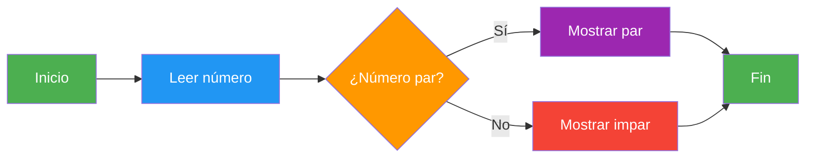
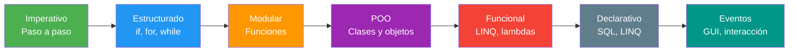
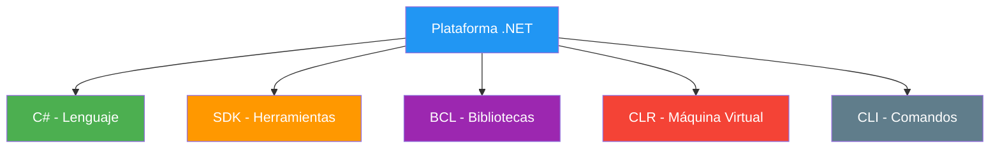
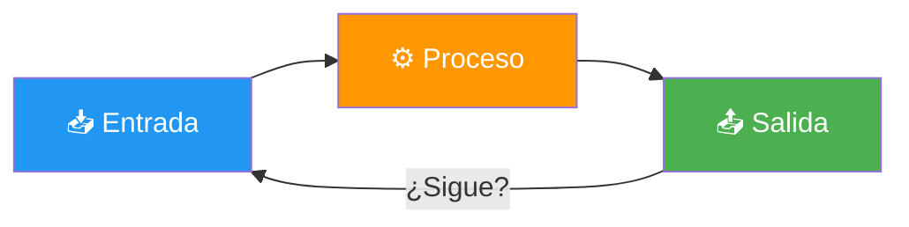
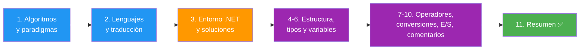
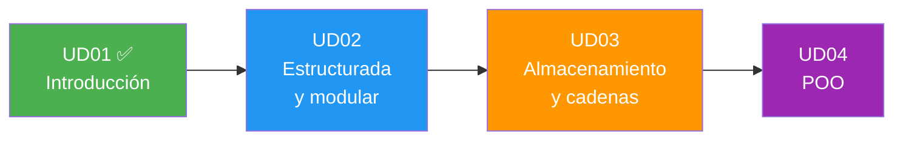

<div class="flex items-center gap-4 w-full">
  
  <span class="ud-pill">Programación · 1DAW · Curso 2026-2027</span>
</div>

# Introducción a la Programación Software

### Del algoritmo en papel a tu primer programa en C#

<div class="mt-10 flex items-end justify-between w-full">
  <div class="text-left">
    <b class="text-lg">José Luis González Sánchez</b><br/>
    <span class="opacity-70">IES Luis Vives · Leganés · <a href="https://joseluisgs.dev">joseluisgs.dev</a></span>
  </div>
  <PacMan :size="54" label="Cargando ideas..." />
</div>

---

## 📦 Materiales de la unidad

Todo el material de la UD01 está publicado en el repositorio de GitHub, organizado por carpetas:

<div class="grid grid-cols-2 gap-6 items-start">
<div>

- 📚 **11 puntos** — teoría, ejemplos reales y resúmenes
- 📝 **Prácticas** — ejercicios graduados en `practicas/`
- 💻 **Soluciones** — proyectos C# con `.slnx` en `Soluciones/`
- 🖼️ **Imágenes y recursos** — diagramas y esquemas en `images/`
- 🎬 **Vídeos** — lista de reproducción en YouTube

</div>
<div class="flex flex-col items-center justify-center gap-4 pt-4">

<RepoBadge caption="Repositorio con materiales de la unidad" size="lg" />

<div class="text-sm opacity-75 text-center max-w-55">

Clónalo, forquéalo o descárgalo en zip: el material siempre está a un clic.

</div>

</div>
</div>

---

## 📚 Índice: los 11 puntos del tema

<div class="grid grid-cols-3 gap-3 text-sm">

<TopicCard :num="1" title="Qué es la programación" desc="Algoritmos, paradigmas y lenguajes" />
<TopicCard :num="2" title="El entorno .NET" desc="SDK, CLI, NuGet e IDE" />
<TopicCard :num="3" title="Soluciones y proyectos" desc=".slnx, .csproj y compilación" />
<TopicCard :num="4" title="Estructura de un programa" desc="Bloques, sentencias y TLP" />
<TopicCard :num="5" title="Tipos de datos" desc="Enteros, texto, lógicos y más" />
<TopicCard :num="6" title="Variables, constantes y literales" desc="Declaración y buenas prácticas" />
<TopicCard :num="7" title="Operadores y expresiones" desc="Aritméticos, lógicos y precedencia" />
<TopicCard :num="8" title="Conversiones de tipo" desc="Implícitas y explícitas" />
<TopicCard :num="9" title="Entrada y salida de datos" desc="Console.ReadLine y WriteLine" />
<TopicCard :num="10" title="Comentarios y documentación" desc="Buenas prácticas de código" />
<TopicCard :num="11" title="Resumen y conclusiones" desc="Cierre de la unidad" />

</div>

<div class="ud-card mt-4 flex items-center justify-between gap-4 px-4 py-2">

<span class="text-sm">📦 <b>Materiales:</b> los 11 puntos, prácticas, soluciones y vídeos de la unidad</span>

<RepoBadge />

</div>

<!--
Pon en el mapa el recorrido completo aunque hoy solo veamos los 3 primeros puntos.
-->

---

## 🎯 Resultados de aprendizaje y criterios

<RaaCcee
  code="RA1"
  title="Reconoce la estructura de un programa informático, identificando y relacionando los elementos propios del lenguaje de programación utilizado."
  :ccee="[
    'Se han identificado los bloques que componen la estructura de un programa informático.',
    'Se han creado proyectos de desarrollo de aplicaciones.',
    'Se han utilizado entornos integrados de desarrollo.',
    'Se han identificado los distintos tipos de variables y la utilidad específica de cada uno.',
    'Se ha modificado el código de un programa para crear y utilizar variables.',
    'Se han creado y utilizado constantes y literales.',
    'Se han clasificado, reconocido y utilizado en expresiones los operadores del lenguaje.',
    'Se ha comprobado el funcionamiento de las conversiones de tipo explícitas e implícitas.',
    'Se han introducido comentarios en el código.',
  ]"
/>

---
layout: section
---

<div class="ud-section-number">01</div>

# Qué es la programación

<div class="opacity-70">Algoritmos, paradigmas y lenguajes</div>

---

## 1 · Punto de partida

<div class="grid grid-cols-2 gap-6 items-start">
<div>

<TipBox type="consejo" title="Punto de partida">

¿Alguna vez has pensado **cómo funciona Netflix** cuando te recomienda una serie, o **cómo Instagram** decide qué posts ves primero? Todo eso es programación. Pero, ¿qué es exactamente programar?

</TipBox>

<TipBox type="analogia">

**Programar es como montar un restaurante:** necesitas ingredientes (datos), una receta (algoritmo), utensilios (operadores) y saber qué pide el cliente (entrada). Si falta alguno, el plato no sale bien.

</TipBox>

</div>
<div>

<Objetivos
  :items="[
    'Definir qué es la programación y por qué es importante',
    'Comprender qué es un algoritmo, sus características y cómo se representa',
    'Conocer los principales paradigmas de programación',
    'Entender por qué C# es el lenguaje que usaremos',
  ]"
/>

</div>
</div>

---

## 🍳 Si programáramos como cocináramos

<div class="text-sm opacity-75 mb-3">Cada concepto de programación tiene su equivalente en la cocina:</div>

<CookingMap />

---

## ¿Qué es programar?

<div class="grid grid-cols-2 gap-5 items-start">
<div>

- **Programar**: escribir instrucciones que un ordenador pueda entender y ejecutar para resolver un problema.
- **Programa**: conjunto de instrucciones escritas en un lenguaje de programación.
- **Algoritmo**: secuencia ordenada de pasos para resolver un problema. El "plan" **antes** de programar.

<TipBox type="nota">

Un ordenador es **muy literal**: no admite ambigüedades. Por eso el algoritmo debe estar bien definido.

</TipBox>

</div>
<div>

<WindowFrame file="Program.cs">

```csharp
// Tu primer programa en C# 14 (Top-Level Statements)
Console.WriteLine("¡Hola, mundo!");
Console.WriteLine("Estoy aprendiendo a programar");
```

</WindowFrame>

<RealExample app="Spotify">

Al decir "reproduce mi lista de favoritos", el programa busca tu lista, verifica permisos, conecta con el servidor, descarga el audio y lo reproduce... en menos de un segundo.

</RealExample>

</div>
</div>

---

## El algoritmo: 6 características

<div class="grid grid-cols-3 gap-3">

<ConceptCard icon="♾️" title="Finito" accent="green">Debe terminar en algún momento: el café se acaba de preparar.</ConceptCard>
<ConceptCard icon="🎯" title="Definido" accent="blue">Cada paso claro: "1 cucharada por taza", no "un poco".</ConceptCard>
<ConceptCard icon="🔢" title="Preciso" accent="purple">Orden específico: no sirves el café antes de prepararlo.</ConceptCard>
<ConceptCard icon="📥" title="Entrada" accent="yellow">Datos que le das: agua, café, azúcar, taza.</ConceptCard>
<ConceptCard icon="📤" title="Salida" accent="accent">Resultado que obtienes: un café listo para beber.</ConceptCard>
<ConceptCard icon="✅" title="Efectividad" accent="green">Cada paso realizable con los recursos disponibles.</ConceptCard>

</div>

<div class="mt-3 text-sm opacity-75">📌 Aplicado a algo que todos conocemos: <b>preparar un café</b> ☕</div>

---

## Ejemplo: preparar un café

<div class="grid grid-cols-2 gap-5 items-start">
<div>

**📥 Entrada:** agua, café en polvo, azúcar, taza, cucharita

**PASOS:**

1. Llenar la cafetera con agua
2. Verter café en el filtro (1 cucharada/taza)
3. Encender la cafetera
4. Esperar a que hierva y pase por el filtro
5. Apagar cuando deje de hacer ruido
6. Verter el café en la taza
7. Añadir azúcar si se desea (y remover)
8. Servir el café

</div>
<div>

**📤 Salida:** un café listo para beber ✅

<TipBox type="nota">

Fíjate en las características: es **finito** (8 pasos), **definido** (cantidades exactas), **preciso** (el orden importa) y tiene **entrada** y **salida**.

</TipBox>

<TipBox type="analogia">

El algoritmo es una **receta**: da igual si cocinas en gas, eléctrica o leña, el resultado es el mismo porque la receta no depende de la herramienta.

</TipBox>

</div>
</div>

---

## Del pseudocódigo a C#

<div class="grid grid-cols-2 gap-4 items-start">
<div>

**🔤 Pseudocódigo** (lenguaje natural estructurado)

```text
INICIO
    LEER agua, cafe, taza
    LLENAR cafetera CON agua
    VERTER cafe EN filtro
    ENCENDER cafetera
    MIENTRAS cafetera NO haya terminado ESPERAR
    APAGAR cafetera
    VERTER cafe EN taza
    SERVIR cafe
FIN
```

</div>
<div>

**💻 La misma idea en C#**

```csharp md:magic-move
string cafe = "café";
string agua = "agua";
string taza = "taza";
```

</div>
</div>

---

## El algoritmo completo en C#

<div class="grid grid-cols-2 gap-5 items-start">
<div>

```csharp md:magic-move
string cafe = "café";
string agua = "agua";
string taza = "taza";

Console.WriteLine($"Paso 1: Llenar la cafetera con {agua}");
Console.WriteLine($"Paso 2: Verter {cafe} en el filtro");
Console.WriteLine("Paso 3: Encender la cafetera");
Console.WriteLine("Paso 4: Esperar a que hierva...");
Console.WriteLine("Paso 5: Apagar la cafetera");
Console.WriteLine($"Paso 6: Verter el café en la {taza}");
Console.WriteLine("Paso 7: ¿Azúcar? Sí/No");
Console.WriteLine("Paso 8: Servir el café");
Console.WriteLine("¡Café listo!");
```

</div>
<div>

<TipBox type="nota">

**Magic Move** ha transformado el código de la slide anterior: el plan se convierte en programa. Así es como se siente pasar de papel a código.

</TipBox>

<TipBox type="advertencia">

**¡Primero el papel, luego el código!** El algoritmo del café estaba escrito **antes** de teclear C#.

</TipBox>

</div>
</div>

---

## Representar algoritmos: 3 formas

<div class="grid grid-cols-3 gap-3">

<ConceptCard icon="🔤" title="Pseudocódigo">Lenguaje natural estructurado: INICIO, LEER, SI, FIN SI.</ConceptCard>
<ConceptCard icon="🔀" title="Diagrama de flujo">Representación gráfica con símbolos y flechas.</ConceptCard>
<ConceptCard icon="💬" title="Lenguaje natural">Descripción en español, sin estructura fija.</ConceptCard>

</div>



<div class="mt-3">

<TipBox type="nota">

Es el mismo algoritmo visto de tres formas. En clase usamos **pseudocódigo** y **diagrama de flujo**.

</TipBox>

</div>

---
layout: statement
---

### ⚠️ Regla de oro

**Análisis → Diseño → Codificación**

Primero el papel (o el borrador), luego el código. Los planos antes de construir la casa.

<div class="ud-card ud-card-accent mt-5">

⏱️ <b>Saltarse ese orden = código desordenado, errores lógicos y <span class="ud-highlight">tiempo perdido</span>.</b>

</div>

---

## Estrategias para diseñar algoritmos

<div class="grid grid-cols-4 gap-3">

<ConceptCard icon="🧩" title="Abstracción">Descomponer un problema complejo en problemas más pequeños.</ConceptCard>
<ConceptCard icon="⚔️" title="Divide y vencerás">Partir en partes independientes y fáciles de resolver.</ConceptCard>
<ConceptCard icon="🚗" title="Encapsulación">Ocultar lo complejo, mostrar solo lo necesario.</ConceptCard>
<ConceptCard icon="🧱" title="Modularidad">Módulos independientes y reutilizables.</ConceptCard>

</div>

<div class="mt-3">

<TipBox type="analogia" title="Analogía">

**Encapsulación** es como un coche: tienes volante y pedales, pero no ves el motor ni la ECU. **Modularidad** es armar mueble de IKEA: piezas que encazan sin fabricarlas desde cero.

</TipBox>

</div>

---

## Paradigmas: formas de programar

| Paradigma | Pregunta clave | Ejemplo en C# |
|----------|----------------|---------------|
| **Imperativo** | ¿Cómo lo hago? | `for`, `while`, línea a línea |
| **Estructurado** | ¿Cómo lo organizo? | `if`, `switch`, `for`, `while` |
| **Modular** | ¿Cómo lo divido? | Funciones, `using` |
| **POO** | ¿Cómo lo modelo? | Clases, objetos, herencia |
| **Funcional** | ¿Qué función aplico? | LINQ, lambdas, `Select` |
| **Declarativo** | ¿Qué quiero? | LINQ, SQL |
| **Eventos** | ¿Qué pasa cuando...? | `Click +=`, `ReadLine` |

<div class="mt-2">

<TipBox type="analogia">

Son **herramientas de un taller**: un martillo (imperativo) clava muy bien, pero no sirve para atornillar. Un buen programador conoce todas y sabe cuándo usar cada una.

</TipBox>

</div>

---

## Evolución de paradigmas



<RealExample app="Netflix">

Usa **eventos** para notificaciones, **funcional** (LINQ) para procesar millones de registros, **POO** para modelar usuarios y **estructurado** para la lógica de negocio. C# es **multiparadigma**.

</RealExample>

---

## Los 3 componentes de un lenguaje

<div class="grid grid-cols-3 gap-3">

<ConceptCard icon="🔡" title="Léxico">Símbolos permitidos: `+ - * / = ; { } ( )`</ConceptCard>
<ConceptCard icon="📐" title="Sintaxis">Reglas de construcción: `int numero = 10;` ✅</ConceptCard>
<ConceptCard icon="🧠" title="Semántica">Significado: `int x = "hola";` ❌ no compila</ConceptCard>

</div>

<div class="grid grid-cols-2 gap-4 mt-3 items-start">
<div>

<WindowFrame file="Componentes.cs">

```csharp
string nombre = "Ana";     // ✅ Válido (sintaxis + semántica)
// int edad = "Ana";       // ❌ Error semántico: texto en un número
// string = "Ana" nombre;  // ❌ Error de sintaxis: el orden no vale
```

</WindowFrame>

</div>
<div>

<TipBox type="truco" title="Truco nemotécnico">

**E**stático = **E**stable (el tipo no cambia). **D**inámico = **D**etermina en ejecución. **F**uerte = **F**allos tempranos. **D**ébil = **D**ejas pasar errores.

C# es **estático y fuerte**.

</TipBox>

</div>
</div>

---

## ¿Compilado o interpretado?

<div class="grid grid-cols-2 gap-4 items-start">
<div>

| Tipo | Cómo funciona | Ejemplo |
|------|---------------|---------|
| **Compilado** | Traduce todo antes de ejecutar | C, C++, Go |
| **Interpretado** | Traduce y ejecuta línea a línea | Python, JavaScript |
| **Mixto (bytecode)** | Compila a IL y ejecuta en máquina virtual | **C# (IL + CLR)** |
| **Transpilador** | Traduce a otro lenguaje alto | TypeScript → JS |

</div>
<div>


</div>
</div>

<TipBox type="analogia" title="Analogía del traductor">

El **compilador** traduce un libro entero del inglés al español antes de dárselo al lector. El **intérprete** es un traductor simultáneo frase a frase. **C# es mixto**: compila a IL y la CLR lo ejecuta con JIT.

</TipBox>

---

## Algoritmo vs programa

<div class="grid grid-cols-2 gap-5 items-start">
<div>

| Característica | Algoritmo | Programa |
|----------------|-----------|----------|
| **Abstracción** | Genérico, sin máquina | Específico, en un lenguaje |
| **Formato** | Pasos lógicos, pseudocódigo | Código ejecutable |
| **Ejecución** | No se ejecuta | Se ejecuta |
| **Fase** | Diseño (antes) | Codificación (durante) |

</div>
<div>

<TipBox type="analogia" title="Analogía">

El algoritmo es el **plano de una casa**. El programa es la **casa construida**. Puedes tener un plano perfecto y construir mal la casa... o construir sin plano (y probablemente se caiga).

</TipBox>

<TipBox type="nota">

Por eso en cada ejercicio empezamos por el **análisis y el diseño en papel**.

</TipBox>

</div>
</div>

---

## Resumen del punto 1

<div class="grid grid-cols-2 gap-5 items-start">
<div>

| Concepto | Definición |
|----------|------------|
| **Programar** | Escribir instrucciones para el ordenador |
| **Algoritmo** | Plan ordenado para resolver un problema |
| **Características** | Finito, definido, preciso, entrada, salida, efectividad |
| **Paradigma** | Estilo de programar (imperativo, POO, funcional...) |
| **Léxico / Sintaxis / Semántica** | Los 3 componentes de un lenguaje |
| **Metáfora cocina** | Ingredientes, receta, utensilios, pedido, plato |

</div>
<div>

<ConceptCard icon="✅" title="Buenas prácticas" accent="green">

- Diseñar el algoritmo **en papel** antes de codificar
- Usar pseudocódigo o diagramas de flujo
- Elegir el paradigma según el problema
- Recordar: algoritmo = plano, programa = casa

</ConceptCard>

<div class="mt-3">

**⏭️ ¿Qué viene después?** En el **punto 2** configuramos el **entorno .NET**: SDK, CLI y NuGet para empezar a programar.

</div>

</div>
</div>

---
layout: section
---

<div class="ud-section-number">02</div>

# El entorno .NET

<div class="opacity-70">SDK, CLI, NuGet e IDE</div>

---

## 2 · ¿Qué es .NET?

<div class="grid grid-cols-2 gap-5 items-start">
<div>

<Objetivos
  :items="[
    'Entender qué es la plataforma .NET y sus componentes',
    'Verificar la instalación del SDK',
    'Usar los comandos básicos de la CLI de .NET',
    'Escribir scripts de C# 14 con dotnet run',
    'Configurar NuGet y entender qué es un paquete',
  ]"
/>

</div>
<div>



</div>
</div>

---

## ¿Cómo funciona tu código?

<div class="grid grid-cols-2 gap-5 items-start">
<div>

1. **Tú escribes** código fuente (`.cs`)
2. **Roslyn** (compilador) lo traduce a código intermedio (**IL**)
3. **La CLR** ejecuta el IL en tu máquina con **JIT**

<TipBox type="analogia" title="Analogía">

**.NET es un restaurante completo:** C# es el idioma en que escribes las recetas, el SDK son las herramientas de cocina, la BCL es la despensa con ingredientes ya preparados y la CLR es el chef que ejecuta las recetas.

</TipBox>

</div>
<div>

<div class="ud-card ud-card-accent mb-3">

**Versiones actuales**

| Versión | Estado | LangVersion |
|---------|--------|-------------|
| .NET 10 | Actual (2025) | C# 14 |
| .NET 11 | **Nuevo (nov 2026)** | C# 15 |

</div>

<TipBox type="nota">

En esta asignatura usamos **.NET 10 + C# 14**, con `LangVersion` 14 en el `.csproj`. **C# 15 ya ha salido (noviembre de 2026)**: lo veremos próximamente.

</TipBox>

</div>
</div>

---

## Instalar y verificar el SDK

<div class="grid grid-cols-2 gap-5 items-start">
<div>

<WindowFrame file="terminal · PowerShell">

```bash
# 1. Descarga el SDK en:
#    https://dotnet.microsoft.com/download

# 2. Verifica la instalación
dotnet --version        # p. ej. 10.0.100

# 3. Mira lo que tienes
dotnet --list-sdks      # SDKs instalados
dotnet --list-runtimes  # Runtimes disponibles
```

</WindowFrame>

</div>
<div>

<TipBox type="advertencia">

Si el comando `dotnet` **no se reconoce**, necesitas reiniciar la terminal o añadir el SDK al **PATH** del sistema.

</TipBox>

<TipBox type="consejo">

Instala el **SDK**, no solo el runtime: el SDK incluye todo lo necesario para desarrollar (compilador, CLI y plantillas).

</TipBox>

<TipBox type="nota">

En **Entornos de Desarrollo** verás en detalle el proceso de traducción y las máquinas virtuales.

</TipBox>

</div>
</div>

---

## La CLI: tus comandos de cada día

<div class="grid grid-cols-2 gap-5 items-start">
<div>

| Comando | Descripción |
|---------|-------------|
| `dotnet new` | Crea un proyecto o solución |
| `dotnet build` | Compila el proyecto |
| `dotnet run` | Compila y ejecuta |
| `dotnet restore` | Restaura paquetes NuGet |
| `dotnet clean` | Limpia archivos de compilación |
| `dotnet sln` | Gestiona soluciones |

</div>
<div>

<WindowFrame file="Crear proyecto paso a paso">

```bash
mkdir MiPrimerProyecto
cd MiPrimerProyecto
dotnet new console
dotnet build
dotnet run
```

</WindowFrame>

</div>
</div>

<div class="mt-2">

<TipBox type="consejo">

`dotnet new console` crea la estructura básica: un `.csproj` (configuración) y un `Program.cs` (tu código). Con `dotnet new list` ves todas las plantillas disponibles (`console`, `webapi`, `classlib`, `xunit`...).

</TipBox>

</div>

---

## Scripting en C# 14: sin proyecto

<div class="grid grid-cols-2 gap-5 items-start">
<div>

<TipBox type="nota">

C# 14 permite ejecutar **un solo archivo `.cs`** como script: sin crear proyecto, con `dotnet run hola.cs`.

</TipBox>

<WindowFrame file="hola.cs">

```csharp
Console.Write("¿Cómo te llamas? ");
string nombre = Console.ReadLine() ?? "";

Console.Write("¿Cuántos años tienes? ");
string texto = Console.ReadLine();
int.TryParse(texto, out int edad);

Console.WriteLine($"¡Hola, {nombre}! Tienes {edad} años.");
```

</WindowFrame>

</div>
<div>

**🛠️ ¿Qué ocurre por debajo?**

`dotnet run` crea un proyecto temporal en caché, restaura paquetes, compila en segundo plano y ejecuta. Tú solo ves el resultado.

<TipBox type="truco" title="Directivas en scripts">

- `#:package Nombre@versión` → añade un paquete NuGet **sin crear proyecto**
- `#:sdk Nombre` → usa otro SDK si el script lo necesita

</TipBox>

</div>
</div>

---

## NuGet: la tienda de paquetes

<div class="grid grid-cols-2 gap-5 items-start">
<div>

<TipBox type="analogia" title="Analogía">

**NuGet es una tienda de aplicaciones**: bibliotecas hechas por otros programadores que puedes usar en tus proyectos (como npm para JavaScript o pip para Python). Hay más de 350.000 paquetes.

</TipBox>

**📦 Paquetes habituales:**

- `Newtonsoft.Json` — trabajar con JSON
- `Microsoft.EntityFrameworkCore` — bases de datos
- `Serilog` — registrar eventos (logs)

</div>
<div>

<WindowFrame file="terminal · NuGet">

```bash
# Instalar un paquete
dotnet add package Newtonsoft.Json

# Versión específica
dotnet add package Newtonsoft.Json --version 13.0.3

# Eliminar
dotnet remove package Newtonsoft.Json

# Buscar
dotnet package search "json"
```

</WindowFrame>

<TipBox type="consejo">

Antes de instalar un paquete, comprueba que esté **mantenido activamente**: fecha de última actualización y número de descargas.

</TipBox>

</div>
</div>

---

## IDEs: dónde escribes tu código

<div class="grid grid-cols-2 gap-4 items-start">

<ConceptCard icon="🚀" title="JetBrains Rider (recomendado)" accent="accent">

IDE completo de JetBrains para C# y .NET. Depurador potente, autocompletado inteligente y refactoring automático. Todo incluido, sin instalar extensiones. **Gratuito con licencia educativa.**

</ConceptCard>

<ConceptCard icon="🪶" title="Visual Studio Code (alternativa)" accent="blue">

Editor ligero y gratuito de Microsoft. Multiplataforma (Windows, macOS, Linux). Más ligero, pero requiere configuración.

</ConceptCard>

</div>

<div class="mt-3">

| Extensión | Descripción | Recomendación |
|-----------|-------------|---------------|
| **ReSharper** (JetBrains) | Análisis de código, refactorizaciones, IntelliSense mejorado | ✅ Principal: tenemos licencia educativa |
| **C# Dev Kit** (Microsoft) | IDE completo para C# en VS Code | Alternativa si no usas ReSharper |

</div>

---

## Resumen del punto 2

<div class="grid grid-cols-2 gap-5 items-start">
<div>

| Componente | Descripción |
|------------|-------------|
| **.NET** | Plataforma de desarrollo de Microsoft |
| **SDK** | Herramientas para desarrollar (no confundir con runtime) |
| **CLI** | Línea de comandos: `new`, `build`, `run`... |
| **Scripting** | Ejecutar C# sin proyecto, solo con un `.cs` |
| **NuGet** | Gestor de paquetes reutilizables |
| **IDE** | Entorno visual: Rider (recomendado) o VS Code |

</div>
<div>

<ConceptCard icon="✅" title="Buenas prácticas" accent="green">

- Verificar siempre la instalación del **SDK** antes de empezar
- Usar **scripts de C# 14** para prototipos rápidos
- Consultar NuGet antes de instalar un paquete
- Usar **Rider** como IDE principal

</ConceptCard>

<div class="mt-3">

**⏭️ ¿Qué viene después?** En el **punto 3** creamos la **solución** y su proyecto de consola.

</div>

</div>
</div>

---
layout: section
---

<div class="ud-section-number">03</div>

# Soluciones y proyectos

<div class="opacity-70">.slnx, .csproj y compilación</div>

---

## 3 · Solución y proyecto

<div class="grid grid-cols-2 gap-5 items-start">
<div>

<Objetivos
  :items="[
    'Diferenciar entre solución y proyecto',
    'Crear soluciones y proyectos desde la línea de comandos',
    'Entender la estructura de archivos de un proyecto',
    'Conocer los archivos .slnx y .csproj',
  ]"
/>

<TipBox type="consejo" title="Punto de partida">

¿Has organizado tus apuntes en carpetas y subcarpetas? En programación hacemos lo mismo: **sin esta organización, un proyecto real sería un caos**.

</TipBox>

</div>
<div>

<ConceptCard icon="🗂️" title="Solución (.slnx)" accent="accent">

Contenedor que agrupa uno o varios proyectos relacionados. **Análogo:** el plan de estudios de un ciclo... dentro, varias asignaturas (proyectos).

</ConceptCard>

<div class="mt-3">

<ConceptCard icon="📦" title="Proyecto (.csproj)" accent="blue">

Conjunto de archivos que se **compilan juntos** para crear un programa o biblioteca. **Análogo:** una asignatura con su contenido y su configuración.

</ConceptCard>

</div>

</div>
</div>

---

## Estructura de archivos

<div class="grid grid-cols-2 gap-4 items-start">
<div>

<WindowFrame file="Árbol de carpetas">

```text
NombreSolucion/
├── NombreSolucion.slnx       ← solución
├── NombreSolucion/           ← proyecto principal
│   ├── NombreSolucion.csproj ← configuración
│   ├── Program.cs            ← tu código
│   ├── Models/
│   └── Services/
└── NombreSolucion.Test/      ← tests (opcional)
    └── NombreSolucion.Test.csproj
```

</WindowFrame>

</div>
<div>

| Archivo / Carpeta | Descripción |
|-------------------|-------------|
| `.slnx` | Referencia a los proyectos de la solución |
| `.csproj` | Configuración (framework, paquetes...) |
| `Program.cs` | Código fuente principal |
| `bin/` | Código compilado — **NO subir a Git** |
| `obj/` | Temporales de compilación — **NO subir a Git** |

</div>
</div>

<TipBox type="advertencia">

La carpeta de la solución y la del proyecto deben tener **el mismo nombre**. Es una convención de .NET que facilita la organización.

</TipBox>

---

## Crear solución y proyecto con la CLI

<div class="grid grid-cols-2 gap-5 items-start">
<div>

<WindowFrame file="terminal · Paso a paso">

```bash
mkdir MiPrimeraSolucion
cd MiPrimeraSolucion
dotnet new sln --name MiPrimeraSolucion
dotnet new console --name MiPrimeraSolucion
dotnet sln add MiPrimeraSolucion/MiPrimeraSolucion.csproj
```

</WindowFrame>

</div>
<div>

<WindowFrame file="terminal · Verificar">

```bash
# Ver qué proyectos contiene
dotnet sln list

# Salida:
# Proyectos en la solución MiPrimeraSolucion:
#   MiPrimeraSolucion/MiPrimeraSolucion.csproj
```

</WindowFrame>

<TipBox type="consejo">

Siempre **primero la solución, luego los proyectos dentro**. Con `dotnet sln add/remove/list` la mantienes al día.

</TipBox>

</div>
</div>

---

## El archivo .csproj

<div class="grid grid-cols-2 gap-4 items-start">
<div>

<WindowFrame file="MiPrimeraSolucion.csproj">

```xml
<Project Sdk="Microsoft.NET.Sdk">

  <PropertyGroup>
    <OutputType>Exe</OutputType>
    <TargetFramework>net10.0</TargetFramework>
    <ImplicitUsings>enable</ImplicitUsings>
    <Nullable>enable</Nullable>
    <TreatWarningsAsErrors>true</TreatWarningsAsErrors>
    <LangVersion>14</LangVersion>
  </PropertyGroup>

</Project>
```

</WindowFrame>

</div>
<div>

| Propiedad | Qué controla |
|-----------|--------------|
| `OutputType` | `Exe` (ejecutable) o `Library` |
| `TargetFramework` | `net10.0` para .NET 10 |
| `ImplicitUsings` | Imports automáticos |
| `Nullable` | Gestión estricta de nulos ✅ |
| `TreatWarningsAsErrors` | Los avisos son errores |
| `LangVersion` | C# 14 en .NET 10 |

<TipBox type="nota">

Para añadir paquetes, un solo comando: `dotnet add package Newtonsoft.Json` — la CLI edita el `.csproj` por ti.

</TipBox>

</div>
</div>

---

## El archivo .slnx

<div class="grid grid-cols-2 gap-5 items-start">
<div>

<WindowFrame file="MiPrimeraSolucion.slnx">

```xml
<Solution>
  <Project Path="MiPrimeraSolucion/MiPrimeraSolucion.csproj" />
  <Project Path="MiPrimeraSolucion.Test/MiPrimeraSolucion.Test.csproj" />
</Solution>
```

</WindowFrame>

<TipBox type="nota">

El `.slnx` es el **nuevo formato XML**: simple y legible. El antiguo `.sln` sigue funcionando pero es más complejo. **Formato por defecto en .NET 10.**

</TipBox>

</div>
<div>

<RealExample app="Netflix / Spotify">

Tienen **cientos de proyectos** en una sola solución: uno para la interfaz, otro para la lógica de negocio, otro para tests... Cuando creas un proyecto en Rider o Visual Studio, internamente se generan un `.slnx` y un `.csproj`.

</RealExample>

<TipBox type="truco" title="Truco">

Si en una carpeta existen `.sln` y `.slnx`, tendrás que indicar cuál usar. Crea solo uno.

</TipBox>

</div>
</div>

---

## Compilar y ejecutar

<div class="grid grid-cols-2 gap-4 items-start">
<div>


<TipBox type="nota">

Roslyn traduce a **IL**, se genera un ensamblado (`.dll`) en `bin/`, y la **CLR** lo ejecuta con **JIT**.

</TipBox>

</div>
<div>

<WindowFrame file="terminal · Compilar">

```bash
# Compilar (genera archivos en bin/)
dotnet build

# Modo Release (optimizado)
dotnet build --configuration Release

# Ejecutar indicando el proyecto
dotnet run --project MiPrimeraSolucion/MiPrimeraSolucion.csproj

# Limpiar / restaurar
dotnet clean
dotnet restore
```

</WindowFrame>

</div>
</div>

---

## Resumen del punto 3

<div class="grid grid-cols-2 gap-5 items-start">
<div>

| Concepto | Descripción |
|----------|-------------|
| **Solución** | Contenedor de proyectos (`.slnx`) |
| **Proyecto** | Código que se compila junto (`.csproj`) |
| **`dotnet new`** | Crea proyectos y soluciones |
| **`dotnet build`** | Compila |
| **`dotnet run`** | Compila y ejecuta |
| **Roslyn** | Compilador de C# |
| **CLR** | Máquina virtual que ejecuta el código |

</div>
<div>

<ConceptCard icon="✅" title="Buenas prácticas" accent="green">

- Primero la solución, luego los proyectos dentro
- Carpeta de solución y proyecto con el **mismo nombre**
- **Nunca** subir `bin/` y `obj/` a Git
- Verificar con `dotnet sln list`

</ConceptCard>

<div class="mt-3">

**⏭️ ¿Qué viene después?** En el **punto 4** abrimos `Program.cs`: bloques, sentencias, expresiones y **Top-Level Statements**.

</div>

</div>
</div>

---
layout: statement
---

### 🎮 De la receta al primer café

Ya tienes el **algoritmo en papel**, el **entorno .NET** montado y la **solución** creada. El siguiente paso: escribir código de verdad.

<div class="text-sm opacity-70 mt-4">Puntos 4 · Estructura de un programa — 5 · Tipos de datos — 6 · Variables...</div>

---
layout: section
---

<div class="ud-section-number">04</div>

# Estructura de un programa

<div class="opacity-70">Bloques, Top-Level Statements y namespaces</div>

---

## 4 · Punto de partida

<div class="grid grid-cols-2 gap-5 items-start">
<div>

<Objetivos
  :items="[
    'Distinguir sentencias, expresiones, métodos y bloques',
    'Escribir tu primer programa con Top-Level Statements',
    'Usar namespaces y using static con criterio',
    'Elegir entre la estructura clásica y la moderna',
  ]"
/>

<TipBox type="consejo" title="Punto de partida">

¿Alguna vez has seguido una receta paso a paso? En C#, cada línea de esa receta es una **sentencia**: una instrucción que el ordenador ejecuta y termina con **`;`**.

</TipBox>

</div>
<div>

<ConceptCard icon="🧱" title="Sentencia" accent="accent">

Instrucción que realiza una acción. Es la **unidad básica de ejecución** y termina siempre con punto y coma (`;`).

</ConceptCard>

<div class="mt-3">

<ConceptCard icon="🧮" title="Expresión" accent="blue">

Código que **produce un valor**: `edad + 1`, `"Hola" + nombre`, `a >= b`.

</ConceptCard>

</div>
</div>
</div>

---

## Entrada → proceso → salida

<div class="grid grid-cols-2 gap-4 items-start">
<div>

| Fase | Qué hace | Ejemplo |
|------|----------|---------|
| **📥 Entrada** | Recibe datos del usuario | `Console.ReadLine()` → `"Ana"` |
| **⚙️ Proceso** | Transforma, calcula, decide | Comprobar si el usuario existe |
| **📤 Salida** | Muestra el resultado | `Console.WriteLine()` → `"Hola, Ana"` |

<TipBox type="nota">

**E → P → S** es el patrón universal: todo programa, desde una calculadora hasta Netflix, hace exactamente estas tres cosas.

</TipBox>

</div>
<div>

<RealExample app="Gmail / Netflix">

Cuando te logueas: **entrada** (escribes usuario y contraseña), **proceso** (el servidor comprueba si coinciden con la base de datos) y **salida** (accedes al perfil o ves un error).

</RealExample>



</div>
</div>

---

## Sentencias, expresiones y bloques

<div class="grid grid-cols-2 gap-4 items-start">
<div>

<WindowFrame file="Program.cs">

```csharp
// Sentencia de declaración
int edad = 22;

// Sentencia de asignación
edad = 23;

// Sentencia de llamada a método
Console.WriteLine("Hola");

// Bloque: varias sentencias entre llaves
if (edad >= 18)
{
    Console.WriteLine("Mayor de edad");
}
```

</WindowFrame>

</div>
<div>

<WindowFrame file="Expresiones que producen valor">

```csharp
int a = 10;
int b = 3;

int suma = a + b;        // 13
int division = a / b;    // 3  (entero)
int resto = a % b;       // 1
bool esPar = a % 2 == 0; // true
```

</WindowFrame>

<TipBox type="advertencia">

Olvidar el **punto y coma** es el error más común de quien empieza. C# es muy estricto con eso.

</TipBox>

</div>
</div>

---

## Top-Level Statements

<div class="grid grid-cols-2 gap-4 items-start">
<div>

<WindowFrame file="Antes (estructura clásica)">

```csharp
namespace MiProyecto
{
    class Program
    {
        static void Main(string[] args)
        {
            Console.WriteLine("¡Hola, mundo!");
        }
    }
}
```

</WindowFrame>

</div>
<div>

<WindowFrame file="Ahora (Top-Level Statements)">

```csharp
Console.WriteLine("¡Hola, mundo!");
```

</WindowFrame>

<TipBox type="nota">

Nació en **C# 9** y es la forma **moderna y recomendada**. **En este curso la usaremos siempre**: sin ceremonia de clases ni `Main`.

</TipBox>

</div>
</div>

<WindowFrame file="return: el final del programa" class="mt-3">

```csharp
Console.Write("¿Cómo te llamas? ");
string nombre = Console.ReadLine() ?? "";

if (string.IsNullOrEmpty(nombre))
{
    return;   // fin del programa: lo que hacía el Main
}

Console.WriteLine($"¡Hola, {nombre}!");
```

</WindowFrame>

<TipBox type="nota">

En la **UD02** veremos **funciones y procedimientos**: allí `return;` marcará el **final de cada uno**, igual que aquí marca el final del programa.

</TipBox>

---

## Reglas de Top-Level Statements

<div class="grid grid-cols-2 gap-4 items-start">
<div>

| # | Regla |
|---|-------|
| 1 | Solo **un archivo** por proyecto los puede usar |
| 2 | Las declaraciones van **directas**, sin `class` ni `Main` |
| 3 | Los `using` van **al inicio** del archivo |
| 4 | Puedes definir **métodos** y usarlos después |

</div>
<div>

<ConceptCard icon="⚠️" title="El archivo se llama Program.cs" accent="orange">

El archivo principal de un proyecto de consola **siempre** se llama `Program.cs`. No le cambies el nombre: el compilador busca ese archivo específicamente.

</ConceptCard>

<TipBox type="truco">

**¿Cuándo usar cada estructura?** Top-Level para scripts, prototipos y aprendizaje. La clásica, cuando el proyecto tiene **muchas clases**.

</TipBox>

</div>
</div>

---

## Namespaces y using static

<div class="grid grid-cols-2 gap-4 items-start">
<div>

<WindowFrame file="Namespace (file-scoped)">

```csharp
namespace MiProyecto.Models;   // C# 10+: sin llaves

enum TipoSuscripcion { Basica, Estandar, Premium }

struct Cancion { string Titulo; int Duracion; }
// Todo esto vive junto y no se mezcla con otros namespaces
```

</WindowFrame>

<TipBox type="nota">

Un **namespace** es como una carpeta que agrupa código relacionado y **evita conflictos de nombres**. En C# 10+ se escribe con punto y coma.

</TipBox>

</div>
<div>

<WindowFrame file="using static">

```csharp
using static System.Console;

// Sin using static
System.Console.WriteLine("Hola");

// Con using static
WriteLine("Hola");
```

</WindowFrame>

<TipBox type="advertencia">

Úsalo solo con clases que usas **siempre** (como `Console`). Si abusas, se pierde legibilidad.

</TipBox>

</div>
</div>

---

## Resumen del punto 4

<div class="grid grid-cols-2 gap-5 items-start">
<div>

| Concepto | Descripción |
|----------|-------------|
| **Sentencia** | Acción que termina en `;` |
| **Expresión** | Código que produce un valor |
| **Bloque** | Sentencias entre `{}` |
| **E → P → S** | Patrón de todo programa |
| **Top-Level** | Código directo, sin `Main` (C# 9+) |
| **Namespace** | Carpeta que agrupa código |
| **`using static`** | Usa miembros estáticos sin el nombre de la clase |

</div>
<div>

<ConceptCard icon="✅" title="Buenas prácticas" accent="green">

- Siempre punto y coma al final de cada sentencia
- Un solo archivo Top-Level por proyecto
- El archivo principal se llama **`Program.cs`**
- Nombres claros: el código debe explicarse solo

</ConceptCard>

<div class="mt-3">

**⏭️ ¿Qué viene después?** En el **punto 5** vemos los **tipos de datos**: cómo manejar la memoria según la información y cuál elegir para cada dato.

</div>

</div>
</div>

---
layout: section
---

<div class="ud-section-number">05</div>

# Tipos de datos

<div class="opacity-70">Cómo manejar la memoria según la información y cuál elegir</div>

---

## 5 · Punto de partida

<div class="grid grid-cols-2 gap-5 items-start">
<div>

<Objetivos
  :items="[
    'Conocer los tipos numéricos y cuándo usar cada uno',
    'Distinguir otros tipos: bool, char y string',
    'Entender la promoción de tipos en operaciones',
    'Diferenciar tipos por valor y por referencia',
  ]"
/>

<TipBox type="consejo" title="Punto de partida">

Si guardas la compra en una caja, eliges la caja **justa**: los tomates no van en la de los huevos. En C#, cada dato tiene su **tipo** y elegirlo mal cuesta memoria y errores.

</TipBox>

</div>
<div>

<ConceptCard icon="🏷️" title="Tipo de dato" accent="accent">

Define **qué valores** puede contener y **cuánta memoria** ocupa. `int`, `double`, `bool`, `string`...

</ConceptCard>

<div class="mt-3">

<ConceptCard icon="🪙" title="Los por defecto" accent="blue">

- `int` → **enteros** (por defecto)
- `double` → **decimales** (por defecto)
- `decimal` → **dinero** 💰

</ConceptCard>

</div>

</div>
</div>

---

## Tipos numéricos

<div class="grid grid-cols-2 gap-4 items-start">
<div>

| Enteros con signo | Tamaño | Rango |
|---|---|---|
| `sbyte` | 8 bits | -128 a 127 |
| `short` | 16 bits | -32.768 a 32.767 |
| **`int`** | 32 bits | ±2.147.483.647 |
| `long` | 64 bits | ±9,2 billones |

| Enteros sin signo | Tamaño | Rango |
|---|---|---|
| `byte` | 8 bits | 0 a 255 |
| `ushort` | 16 bits | 0 a 65.535 |
| `uint` | 32 bits | 0 a 4.294.967.295 |
| `ulong` | 64 bits | 0 a 18,4 billones |

</div>
<div>

| Decimales | Precisión | Uso típico |
|---|---|---|
| `float` | ~6-9 dígitos | poco uso (sufijo `f`) |
| **`double`** | ~15-17 dígitos | **por defecto** en decimales |
| `decimal` | ~28-29 dígitos | **dinero** (sufijo `m`) |

<TipBox type="advertencia">

Un `byte` guarda hasta **255**: si una puntuación pasa de ahí, **desborda**. Para dinero, nunca uses `int` ni `double`: siempre `decimal`.

</TipBox>

</div>
</div>

---

## Otros tipos de datos

<div class="grid grid-cols-2 gap-4 items-start">
<div>

| Tipo | Valores | Por defecto |
|---|---|---|
| **`bool`** | `true` / `false` | `false` |
| **`char`** | Un carácter Unicode | `'\0'` |
| **`string`** | Texto (variable) | **`null`** |

<WindowFrame file="Ejemplos">

```csharp
bool activo = true;
char inicial = 'J';          // comillas simples
string nombre = "José Luis"; // comillas dobles
```

</WindowFrame>

</div>
<div>

<ConceptCard icon="🔍" title="El tipo var" accent="green">

C# **infiera** el tipo a partir del valor asignado. El tipo **no cambia** después:

```csharp
var edad = 22;      // int
var nombre = "Ana"; // string
```

</ConceptCard>

<TipBox type="nota">

Hay más tipos: `DateTime`, `Guid`, tuplas `(int, string)`... Los verás cuando los necesites.

</TipBox>

</div>
</div>

---

## Promoción de tipos

<div class="grid grid-cols-2 gap-4 items-start">
<div>

<WindowFrame file="La regla de oro">

```csharp
byte a = 10;
byte b = 20;
var c = a + b;   // tipo de c: ¡int, no byte!
```

</WindowFrame>

<TipBox type="nota">

Cuando operas con tipos distintos, C# **eleva** el más pequeño al más grande. Toda operación entera promociona a **mínimo `int`**.

</TipBox>

<RealExample app="Sonda Mars Climate Orbiter">

En 1999 se perdió una sonda por mezclar unidades imperiales y métricas.

</RealExample>

</div>
<div>

| Prioridad (de mayor a menor) | Gana |
|---|---|
| 1 | `decimal` (nunca con `float`/`double`) |
| 2 | `double` |
| 3 | `float` |
| 4 | `long` |
| 5 | `uint` (con `int` → `long`) |
| 6 | **todo lo demás → `int`** |

</div>
</div>

---

## Por valor o por referencia

<div class="grid grid-cols-2 gap-4 items-start">
<div>

| Categoría | Tipos | Al copiar... |
|---|---|---|
| **Por valor** 📦 | `int`, `double`, `bool`, `char` | Se copia el **contenido** (Stack) |
| **Por referencia** 🔗 | `string`, `array`, clases | Se copia la **referencia** (dato en Heap) |

<TipBox type="nota">

**Stack:** rápido y ordenado, para datos fijos. **Heap:** flexible, para objetos de tamaño variable.

</TipBox>

</div>
<div>

<WindowFrame file="null: el error clásico">

```csharp
string nombre;        // vale null (no "vacío")
Console.WriteLine(nombre.Length);
// ❌ NullReferenceException
```

</WindowFrame>

<TipBox type="truco">

Protección: `string x = nombre ?? "Desconocido";` — si es `null`, usa el valor de la derecha.

</TipBox>

<TipBox type="advertencia">

Usar un valor `null` como si tuviera objeto es **el error más común** en programación.

</TipBox>

</div>
</div>

---

## Resumen del punto 5

<div class="grid grid-cols-2 gap-5 items-start">
<div>

| Concepto | Descripción |
|----------|-------------|
| **`int`** | Enteros, tipo por defecto |
| **`double`** | Decimales, por defecto |
| **`decimal`** | Dinero y finanzas |
| **`bool` / `char` / `string`** | Lógico, carácter, texto |
| **`var`** | El compilador infiere el tipo |
| **Promoción** | El más grande manda en la operación |
| **Por valor / referencia** | Stack vs Heap |

</div>
<div>

<ConceptCard icon="✅" title="Buenas prácticas" accent="green">

- `int` para enteros, `decimal` para dinero
- `var` cuando el tipo es evidente
- Cuidado con `null` en `string`
- Guion bajo en números grandes: `1_500_000`

</ConceptCard>

<div class="mt-3">

**⏭️ ¿Qué viene después?** En el **punto 6**: **variables, constantes y literales** — cómo guardar esos datos con nombre.

</div>

</div>
</div>

---
layout: section
---

<div class="ud-section-number">06</div>

# Variables, constantes y literales

<div class="opacity-70">Cómo guardar los datos con nombre</div>

---

## 6 · Punto de partida

<div class="grid grid-cols-2 gap-5 items-start">
<div>

<Objetivos
  :items="[
    'Declarar variables con buenas prácticas de nombres',
    'Protegerte de los valores null',
    'Distinguir variable, constante y literal',
    'Agrupar datos con enum, struct y tuplas',
  ]"
/>

<TipBox type="consejo" title="Punto de partida">

¿Cómo guardarías el precio de la compra para usarlo luego? En C#, en una **variable**: una zona de memoria con nombre donde guardas un dato que puede cambiar.

</TipBox>

</div>
<div>

<ConceptCard icon="📦" title="Variable" accent="accent">

Contenedor con nombre que almacena un dato que **puede cambiar** durante la ejecución: `int edad = 22;`

</ConceptCard>

<div class="mt-3">

<ConceptCard icon="🏷️" title="Identificador" accent="blue">

El **nombre** que le damos a variables, constantes, métodos o clases. Es la etiqueta con la que nos referimos a algo.

</ConceptCard>

</div>

</div>
</div>

---

## Declarar y nombrar

<div class="grid grid-cols-2 gap-4 items-start">
<div>

<WindowFrame file="Declaración">

```csharp
int edad = 22;        // declaración + valor
edad = 23;            // asignación (cambia)

string nombre = "Ana";
double nota = 8.75;
```

</WindowFrame>

<TipBox type="advertencia">

Si una variable local **no está inicializada** y la usas, el compilador da error. Se evitan bugs con valores "basura" de memoria.

</TipBox>

</div>
<div>

| Tipo | Nombre | Ejemplo |
|---|---|---|
| Variable | **camelCase** | `int edadDelAlumno` |
| Constante | **PascalCase** | `const double Iva` |
| Clase/método | **PascalCase** | `CalcularTotal()` |

<ConceptCard icon="✅" title="Código autoexplicativo" accent="green">

❌ `int d = 30;` → ✅ `int diasDelMes = 30;`

Un buen programador escribe código que **se entiende solo**.

</ConceptCard>

</div>
</div>

---

## Ámbito y vida de una variable

<div class="grid grid-cols-2 gap-4 items-start">
<div>

<WindowFrame file="Ámbito (scope)">

```csharp
int total = 100;      // visible en todo el método

if (true)
{
    int descuento = 10; // solo dentro de las llaves
    Console.WriteLine(total + descuento);
}

Console.WriteLine(descuento); // ❌ fuera de ámbito
```

</WindowFrame>

<TipBox type="nota">

Si anidas demasiados bloques, las variables de dentro se vuelven difíciles de seguir. **Anida lo justo.**

</TipBox>

</div>
<div>

<ConceptCard icon="📍" title="Ámbito (scope)" accent="accent">

Zona del código donde la variable **es visible** y puede usarse.

</ConceptCard>

<div class="mt-3">

<ConceptCard icon="⏱️" title="Vida (lifetime)" accent="blue">

**Cuánto tiempo vive**: mientras se ejecuta su bloque. Al salir, la memoria se libera.

</ConceptCard>

</div>

</div>
</div>

---

## Null y tipos nullable

<div class="grid grid-cols-2 gap-4 items-start">
<div>

<WindowFrame file="El error del billón de dólares">

```csharp
string nombre;           // vale null, NO ""
Console.WriteLine(nombre.Length);
// ❌ NullReferenceException

// Protección con ??
string seguro = nombre ?? "Desconocido";
```

</WindowFrame>

<TipBox type="nota">

`null` significa **"no apunta a ningún objeto"**. Con `<Nullable>enable</Nullable>` el compilador te avisa antes de que falle.

</TipBox>

</div>
<div>

<WindowFrame file="Comprobar antes de usar">

```csharp
string nombre = null;

// ¿Sin valor o vacío?
if (string.IsNullOrEmpty(nombre))
{
    Console.WriteLine("Falta el nombre");
}

// Longitud solo si tiene valor
int? longitud = nombre?.Length;
```

</WindowFrame>

<RealExample app="Formularios web">

Si el usuario deja un campo vacío, el servidor comprueba `IsNullOrEmpty` antes de usarlo: **evitas el fallo sin complicarte**.

</RealExample>

</div>
</div>

---

## Constantes y literales

<div class="grid grid-cols-2 gap-4 items-start">
<div>

| Característica | Variable | Constante | Literal |
|---|---|---|---|
| **Puede cambiar** | Sí | **No** | No |
| **Se declara** | Con tipo | con `const` | No se declara |
| **Ejemplo** | `int x = 5;` | `const int X = 5;` | `5` |

<WindowFrame file="const">

```csharp
const double Iva = 21.0;
const string Pais = "España";

Iva = 22.0;   // ❌ error de compilación
```

</WindowFrame>

</div>
<div>

| `const` | `readonly` |
|---|---|
| Se asigna en la **declaración** | Se asigna en el **constructor** |
| Tiempo: **compilación** | Tiempo: **ejecución** |
| Valores que **nunca** cambian | Valores que cambian rara vez |

<TipBox type="nota">

Un **literal** es el valor en sí escrito en el código: `5`, `"hola"`, `true`, `21.0m`. No tiene nombre.

</TipBox>

<TipBox type="advertencia">

Como las constantes se reemplazan **en compilación**, no puedes usar valores calculados en ejecución.

</TipBox>

</div>
</div>

---

## Enum, struct y tupla

<div class="grid grid-cols-3 gap-4 items-start">
<div>

<ConceptCard icon="📋" title="enum" accent="accent">

Conjunto de **valores con nombre**. Solo admite los definidos.

```csharp
enum TipoSuscripcion
{ Basica, Estandar, Premium }
```

</ConceptCard>

</div>
<div>

<ConceptCard icon="🧰" title="struct" accent="blue">

Agrupa varios campos bajo un mismo nombre (mini-cajita).

```csharp
struct Cancion
{
    string Titulo;
    int DuracionSegundos;
}
```

</ConceptCard>

</div>
<div>

<ConceptCard icon="📦" title="tupla" accent="green">

Agrupa valores **sin crear clase**. Rápida y temporal.

```csharp
var compra = ("Pan", 1.20m, 2);
Console.WriteLine(compra.Item2);
```

</ConceptCard>

</div>
</div>

<TipBox type="truco">

**Regla práctica:** 2-3 valores temporales → **tupla**. Modelo con sentido propio (canción, jugador) → **struct**. Opciones fijas → **enum**.

</TipBox>

---

## Resumen del punto 6

<div class="grid grid-cols-2 gap-5 items-start">
<div>

| Concepto | Descripción |
|----------|-------------|
| **Variable** | Contenedor que cambia (`int x = 5;`) |
| **Identificador** | Nombre de variable, método, clase... |
| **Ámbito** | Dónde es visible la variable |
| **`null`** | "No apunta a ningún objeto" |
| **Constante** | `const`: no cambia jamás |
| **Literal** | El valor escrito en el código |
| **`enum` / `struct` / `tupla`** | Opciones, entidades, paquetes rápidos |

</div>
<div>

<ConceptCard icon="✅" title="Buenas prácticas" accent="green">

- **camelCase** en variables, **PascalCase** en constantes
- Nombres que se entienden sin comentarios
- Protege los `string` con `??`
- Inicializa siempre al declarar

</ConceptCard>

<div class="mt-3">

**⏭️ ¿Qué viene después?** En el **punto 7**: **operadores y expresiones** — cómo calcular con todo lo que has guardado.

</div>

</div>
</div>

---
layout: section
---

<div class="ud-section-number">07</div>

# Operadores y expresiones

<div class="opacity-70">Calcular, comparar y decidir</div>

---

## 7 · Punto de partida

<div class="grid grid-cols-2 gap-5 items-start">
<div>

<Objetivos
  :items="[
    'Usar operadores aritméticos y relacionales',
    'Combinar condiciones con operadores lógicos',
    'Elegir bien la precedencia en operaciones',
    'Aplicar el ternario y la coalescencia nula',
  ]"
/>

<TipBox type="consejo" title="Punto de partida">

En la calculadora pulsas `+` y `−`. En C# haces lo mismo, pero además puedes **comparar** (`>`, `==`) y **combinar condiciones** (`&&`, `||`).

</TipBox>

</div>
<div>

<ConceptCard icon="🧮" title="Expresión" accent="accent">

Combinación de valores, variables y operadores que **produce un resultado**: `precio * 1.21`

</ConceptCard>

<div class="mt-3">

<ConceptCard icon="⚙️" title="Operandos y operador" accent="blue">

**Operandos:** el dato sobre el que se opera (`precio`, `1.21`). **Operador:** la instrucción (`*`).

</ConceptCard>

</div>

</div>
</div>

---

## Operadores aritméticos

<div class="grid grid-cols-2 gap-4 items-start">
<div>

| Operador | Nombre | Ejemplo | Resultado |
|---|---|---|---|
| `+` `-` `*` | Suma, resta, mult. | `5 + 3` | `8` |
| `/` | División | `5 / 3` | `1` |
| `%` | Módulo (resto) | `5 % 3` | `2` |
| `++` `--` | Incremento | `x++` | `x = x + 1` |

<TipBox type="nota">

El **módulo** (`%`) sirve, por ejemplo, para saber si un número es **par**: `numero % 2 == 0`.

</TipBox>

</div>
<div>

<WindowFrame file="Cuidado con la división">

```csharp
int a = 10, b = 3;

Console.WriteLine(a / b);              // 3  (¡trunca!)
Console.WriteLine((double)a / b);      // 3.333...
```

</WindowFrame>

<TipBox type="advertencia">

La división entre enteros **trunca, no redondea**: `10 / 3` da `3`, no `3.33`. Convierte antes con `(double)`.

</TipBox>

<TipBox type="truco">

`x += 3` es "suma y asigna". `x = +3` es "asigna un positivo": **no dan el mismo resultado** y el compilador no avisa.

</TipBox>

</div>
</div>

---

## Comparar y combinar

<div class="grid grid-cols-2 gap-4 items-start">
<div>

| Relacionales | Significado |
|---|---|
| `==` `!=` | igual / distinto |
| `>` `<` `>=` `<=` | mayor, menor... |

| Lógicos | Significado |
|---|---|
| `&&` | **Y** (ambas ciertas) |
| `\|\|` | **O** (al menos una) |
| `!` | **NO** (invierte) |

<TipBox type="nota">

Todos devuelven **`bool`**: `true` o `false`.

</TipBox>

</div>
<div>

<WindowFrame file="Cortocircuito">

```csharp
int edad = 20;
// Si la primera es false, la segunda NO se evalúa
bool ok = edad >= 18 && HaySuficienteDinero();

// ??= asigna solo si es null
string apodo = null;
apodo ??= "Invitado";
```

</WindowFrame>

<TipBox type="truco">

El `&&` y el `||` usan **cortocircuito**: si el resultado ya está decidido, no gastan tiempo en el segundo término.

</TipBox>

</div>
</div>

---

## Leyes de De Morgan

<div class="grid grid-cols-2 gap-4 items-start">
<div>

| Original | Equivalente |
|---|---|
| `!(A && B)` | `!A \|\| !B` |
| `!(A \|\| B)` | `!A && !B` |

<RealExample app="Netflix">

"Recomendar si te gustó la película X **y** es de suspense **o** es de terror": así se ven sus reglas de recomendación combinando condiciones.

</RealExample>

</div>
<div>

<WindowFrame file="Negar una condición">

```csharp
bool esAdulto = edad >= 18;

// ❌ Confuso
if (!(edad >= 18)) { }

// ✅ Más claro
if (edad < 18) { }
```

</WindowFrame>

<TipBox type="advertencia">

**`=` asigna** y **`==` compara**. Si escribes `if (x = 5)` el compilador avisa... pero no siempre lo verás.

</TipBox>

</div>
</div>

---

## Ternario y coalescencia

<div class="grid grid-cols-2 gap-4 items-start">
<div>

<WindowFrame file="Operador ternario">

```csharp
int edad = 20;

string mensaje = (edad >= 18)
    ? "Mayor de edad"
    : "Menor de edad";

Console.WriteLine(mensaje);
```

</WindowFrame>

<TipBox type="nota">

**Sintaxis:** `(condición) ? valor_si_true : valor_si_false`. Elige **uno de dos valores**.

</TipBox>

</div>
<div>

<WindowFrame file="Coalescencia ??">

```csharp
string nombre = null;

// Si es null, usa el valor de la derecha
string seguro = nombre ?? "Desconocido";

// ?? es un ternario rápido para null
string v2 = nombre != null ? nombre : "Desconocido";
```

</WindowFrame>

<TipBox type="advertencia">

No anides más de **3 niveles** de ternario: el código se vuelve ilegible. Un ternario por línea.

</TipBox>

</div>
</div>

---

## Precedencia de operadores

<div class="grid grid-cols-2 gap-4 items-start">
<div>

| # | Operadores |
|---|---|
| 1 | `()` paréntesis |
| 2 | `++` `--` `!` |
| 3 | `*` `/` `%` |
| 4 | `+` `-` |
| 5 | `<` `>` `<=` `>=` |
| 6 | `==` `!=` |
| 7 | `&&` |
| 8 | `\|\|` |

</div>
<div>

<WindowFrame file="El error silencioso">

```csharp
// ¿108,9 o 118,9?
double total = base + iva * (1 - dto);
// ✅ con paréntesis explícitos
double ok = (base + iva) * (1 - dto);
```

</WindowFrame>

<TipBox type="advertencia">

Este tipo de error **no avisa al compilar**: es de los más peligrosos. **Cuando dudes, usa paréntesis.**

</TipBox>

</div>
</div>

---

## Resumen del punto 7

<div class="grid grid-cols-2 gap-5 items-start">
<div>

| Tipo | Operadores | Uso |
|---|---|---|
| **Aritméticos** | `+ - * / % ++ --` | Cálculos |
| **Asignación** | `= += -= *= /= %=` | Guardar valores |
| **Relacionales** | `== != > < >= <=` | Comparar |
| **Lógicos** | `&& \|\| !` | Combinar condiciones |
| **Ternario** | `? :` | Elegir entre dos valores |
| **Coalescencia** | `??` | Valor por defecto si `null` |

</div>
<div>

<ConceptCard icon="✅" title="Buenas prácticas" accent="green">

- División entre enteros: convierte con `(double)`
- Paréntesis cuando dudes de la precedencia
- Un ternario por línea, máximo 3 niveles
- `==` compara, `=` asigna

</ConceptCard>

<div class="mt-3">

**⏭️ ¿Qué viene después?** En el **punto 8**: **conversiones de tipo** — cómo convertir un dato de un tipo a otro sin romper nada.

</div>

</div>
</div>

---
layout: section
---

<div class="ud-section-number">08</div>

# Conversiones de tipo

<div class="opacity-70">Convertir datos entre tipos sin romper nada</div>

---

## 8 · Punto de partida

<div class="grid grid-cols-2 gap-5 items-start">
<div>

<Objetivos
  :items="[
    'Distinguir conversiones implícitas y explícitas',
    'Convertir texto a número de forma segura',
    'Elegir entre Parse, TryParse y Convert',
    'Evitar los errores clásicos de conversión',
  ]"
/>

<TipBox type="consejo" title="Punto de partida">

`Console.ReadLine()` siempre devuelve **texto**. Si el usuario escribe "25" y tú necesitas un número, toca **convertir**: ese es el oficio de este punto.

</TipBox>

</div>
<div>

<ConceptCard icon="🔄" title="Conversión de tipo" accent="accent">

Cambiar un valor de un tipo a otro: `int` → `double`, o `string` → `int`.

</ConceptCard>

<div class="mt-3">

<ConceptCard icon="🚦" title="Implícita vs explícita" accent="blue">

- **Implícita:** la hace el compilador (sin riesgo).
- **Explícita (cast):** la pides tú con `(tipo)`.

</ConceptCard>

</div>

</div>
</div>

---

## Implícitas y explícitas

<div class="grid grid-cols-2 gap-4 items-start">
<div>

| Conversión | ¿Pierde datos? | Ejemplo |
|---|---|---|
| **Implícita** (pequeño → grande) | **No** | `int` → `double` |
| **Explícita** (grande → pequeño) | **Sí** | `double` → `int` |

<WindowFrame file="Implícita: automática">

```csharp
int edad = 22;
double nota = edad;   // OK, sin avisar
// 22 pasa a ser 22.0
```

</WindowFrame>

</div>
<div>

<WindowFrame file="Explícita: cast">

```csharp
double pi = 3.99;
int entero = (int)pi;   // ¡3! Trunca, no redondea

long grande = 1000;
int pequeño = (int)grande; // OK si cabe
```

</WindowFrame>

<TipBox type="advertencia">

El cast **corta la parte decimal**: `(int)3.99` da `3`, no `4`. Y si el número no cabe, se **desborda** sin aviso.

</TipBox>

</div>
</div>

---

## Parse, TryParse y Convert

<div class="grid grid-cols-2 gap-4 items-start">
<div>

| Situación | Usa | Si falla |
|---|---|---|
| El texto **siempre** es válido | `Parse()` | Excepción 💥 |
| El texto **viene del usuario** | `TryParse()` | Devuelve `false` ✅ |
| Puede ser `null` | `Convert.ToInt32()` | Devuelve `0` |

<WindowFrame file="TryParse: el seguro">

```csharp
string texto = "42";

bool ok = int.TryParse(texto, out int resultado);
string msg = ok ? $"Es: {resultado}"
                : "No es un número";
```

</WindowFrame>

</div>
<div>

<ConceptCard icon="🛡️" title="Regla de oro" accent="green">

Con datos de usuario → **siempre `TryParse`**. Nunca `Parse` en producción.

</ConceptCard>

<TipBox type="nota">

`out` es un **parámetro de salida**: el método siempre rellena la variable. Si falla, queda el valor por defecto (`0`).

</TipBox>

</div>
</div>

---

## Errores comunes de conversión

<div class="grid grid-cols-2 gap-4 items-start">
<div>

<WindowFrame file="❌ Mal">

```csharp
// Excepción si el usuario escribe "abc"
int edad = int.Parse(Console.ReadLine());

// Trunca en vez de redondear
double precio = 3.99;
int euros = (int)precio;      // 3

// División entera
int r = 10 / 3;               // 3
```

</WindowFrame>

</div>
<div>

<WindowFrame file="✅ Bien">

```csharp
int.TryParse(Console.ReadLine(), out int edad);

double precio = 3.99;
int euros = (int)Math.Round(precio); // 4

double r = 10 / 3.0;           // 3.33
```

</WindowFrame>

<RealExample app="Formularios web">

Cuando pides el código postal y lo conviertes a número, el servidor usa `TryParse`: si escribes "abc", **detecta el error sin romperse**.

</RealExample>

</div>
</div>

---

## Resumen del punto 8

<div class="grid grid-cols-2 gap-5 items-start">
<div>

| Tipo | Cómo se hace | Cuándo usarla |
|---|---|---|
| **Implícita** | Automática | Sin riesgo de pérdida |
| **Explícita** | `(tipo)valor` | Tú controlas la pérdida |
| **`Parse`** | `int.Parse(txt)` | Texto 100% fiable |
| **`TryParse`** | `int.TryParse(txt, out r)` | **Datos de usuario** |
| **`Convert`** | `Convert.ToInt32(v)` | Tolerante con `null` |

</div>
<div>

<ConceptCard icon="✅" title="Buenas prácticas" accent="green">

- Datos de usuario → **`TryParse`** siempre
- El cast **trunca**: redondea antes si hace falta
- Convierte antes de dividir si necesitas decimales
- Comprueba también el rango si `0` no vale

</ConceptCard>

<div class="mt-3">

**⏭️ ¿Qué viene después?** En el **punto 9**: **entrada y salida de datos** — cómo hablar con el usuario.

</div>

</div>
</div>

---
layout: section
---

<div class="ud-section-number">09</div>

# Entrada y salida de datos

<div class="opacity-70">Hablar con el usuario</div>

---

## 9 · Punto de partida

<div class="grid grid-cols-2 gap-5 items-start">
<div>

<Objetivos
  :items="[
    'Mostrar datos con Write y WriteLine',
    'Unir textos con concatenación e interpolación',
    'Leer lo que escribe el usuario con ReadLine',
    'Convertir esa lectura a número de forma segura',
  ]"
/>

<TipBox type="consejo" title="Punto de partida">

Todo programa habla: **muestra** algo por pantalla y **pregunta** algo al usuario. En C#, todo eso vive en la clase `Console`.

</TipBox>

</div>
<div>

<ConceptCard icon="📤" title="Salida" accent="accent">

`Console.WriteLine()` escribe y **salta de línea**; `Console.Write()` escribe **sin** saltar.

</ConceptCard>

<div class="mt-3">

<ConceptCard icon="📥" title="Entrada" accent="blue">

`Console.ReadLine()` lee lo que escribe el usuario. **Siempre devuelve `string`**.

</ConceptCard>

</div>

</div>
</div>

---

## Salida: Write y WriteLine

<div class="grid grid-cols-2 gap-4 items-start">
<div>

<WindowFrame file="Interpolación de strings">

```csharp
string nombre = "Ana";
int edad = 22;

// ❌ Concatenación: poco legible
Console.WriteLine("Hola " + nombre +
                  ", tienes " + edad + " años");

// ✅ Interpolación con $
Console.WriteLine($"Hola {nombre}, tienes {edad} años");
```

</WindowFrame>

</div>
<div>

| Operación | Cómo | Ejemplo |
|---|---|---|
| Salto de línea | `WriteLine()` | `WriteLine("Hola")` |
| Sin salto | `Write()` | `Write("Hola ")` |
| Concatenación | `+` | `"Hola " + nombre` |
| Interpolación | `$""` | `$"Hola {nombre}"` |

<WindowFrame file="Formatos">

```csharp
Console.WriteLine($"Precio: {precio:F2}");  // 19,99
Console.WriteLine($"Aprobado: {0.85:P0}");  // 85 %
Console.WriteLine($"Total: {1000000:N0}");  // 1.000.000
```

</WindowFrame>

</div>
</div>

---

## Entrada: Console.ReadLine

<div class="grid grid-cols-2 gap-4 items-start">
<div>

<WindowFrame file="Pedir datos">

```csharp
Console.Write("¿Cuántos años tienes? ");
string texto = Console.ReadLine();

int.TryParse(texto, out int edad);

Console.WriteLine($"Tienes {edad} años");
```

</WindowFrame>

<TipBox type="nota">

Usa `Write` para el mensaje: así el cursor **se queda en la misma línea** esperando lo que escriba el usuario.

</TipBox>

</div>
<div>

<ConceptCard icon="⚠️" title="Siempre string" accent="orange">

`ReadLine()` devuelve **texto**. Para necesitar un número, convierte con `TryParse` (punto 8).

</ConceptCard>

<TipBox type="truco">

Alinea en columnas: `{nombre,-10}` izquierda (texto) · `{nota,6}` derecha (números).

</TipBox>

</div>
</div>

---

## Resumen del punto 9

<div class="grid grid-cols-2 gap-5 items-start">
<div>

| Operación | Método | Ejemplo |
|---|---|---|
| **Salida con salto** | `WriteLine()` | `WriteLine("Hola")` |
| **Salida sin salto** | `Write()` | `Write("Hola ")` |
| **Concatenación** | `+` | `"Hola " + nombre` |
| **Interpolación** | `$""` | `$"Hola {nombre}"` |
| **Entrada** | `ReadLine()` | `string x = ReadLine()` |

</div>
<div>

<ConceptCard icon="✅" title="Buenas prácticas" accent="green">

- `WriteLine` para la mayoría de salidas
- **Interpolación** `$""` en vez de concatenar con `+`
- `ReadLine` → siempre `string` → `TryParse`
- Mensajes claros al pedir datos

</ConceptCard>

<div class="mt-3">

**⏭️ ¿Qué viene después?** En el **punto 10**: **comentarios y documentación** — cómo explicar tu código a los demás.

</div>

</div>
</div>

---
layout: section
---

<div class="ud-section-number">10</div>

# Comentarios y documentación

<div class="opacity-70">Explicar tu código a los demás</div>

---

## 10 · Punto de partida

<div class="grid grid-cols-2 gap-5 items-start">
<div>

<Objetivos
  :items="[
    'Escribir comentarios de una línea y de varios',
    'Comentar el por qué, no el qué',
    'Documentar con XMLDoc las APIs públicas',
    'Evitar comentarios obsoletos y código muerto',
  ]"
/>

<TipBox type="consejo" title="Punto de partida">

El **80 %** del tiempo de un programador no es escribir código nuevo, sino **leer y mantener** el de otros. Tu comentario será la ayuda de quien venga después.

</TipBox>

</div>
<div>

<ConceptCard icon="💬" title="Comentario" accent="accent">

Nota que escribe el programador para explicar el código. El compilador **lo ignora por completo**.

</ConceptCard>

<div class="mt-3">

<ConceptCard icon="📖" title="Documentación" accent="blue">

Comentarios `///` que aparecen como **tooltip** en el IDE al pasar el ratón.

</ConceptCard>

</div>

</div>
</div>

---

## Tipos de comentarios

<div class="grid grid-cols-2 gap-4 items-start">
<div>

<WindowFrame file="Comentarios en C#">

```csharp
// Una línea: explicación breve

/* Varias líneas:
   para explicar algo largo
   que ocupa varias líneas */

int total = 100;  // al final de la línea
```

</WindowFrame>

</div>
<div>

| Tipo | Sintaxis | Uso |
|---|---|---|
| **Una línea** | `// texto` | Explicaciones breves |
| **Varias líneas** | `/* texto */` | Bloques largos |
| **XMLDoc** | `/// <summary>` | Documentación de API |

<TipBox type="nota">

Los comentarios **no afectan al programa**: puedes añadirlos o quitarlos sin miedo (aunque un comentario viejo sí puede engañarte).

</TipBox>

<TipBox type="advertencia">

Nunca dejes **código comentado** para "guardarlo": eso es trabajo para Git, no para el código.

</TipBox>

</div>
</div>

---

## Comentar el por qué, no el qué

<div class="grid grid-cols-2 gap-4 items-start">
<div>

<WindowFrame file="❌ MAL">

```csharp
// Cuenta el contador
int contador = 0;

// El IVA es del 16 %
double iva = 0.21;   // ¡el comentario miente!
```

</WindowFrame>

</div>
<div>

<WindowFrame file="✅ BIEN">

```csharp
// El IVA general es del 21 % (Ley 37/1992)
double iva = 0.21;

// Sin descuento porque es campaña de navidad
double total = precio * 1.21;
```

</WindowFrame>

<RealExample app="Equipos de 5-15 personas">

En Google, Microsoft o Spotify el mismo código lo tocan 3-4 programadores distintos. **Los buenos comentarios ahorran tiempo y dinero.**

</RealExample>

</div>
</div>

---

## Documentación XML

<div class="grid grid-cols-2 gap-4 items-start">
<div>

<WindowFrame file="xml doc">

```csharp
/// <summary>
/// Calcula la suma de dos números.
/// </summary>
/// <param name="a">Primer número.</param>
/// <param name="b">Segundo número.</param>
/// <returns>La suma de ambos.</returns>
int Sumar(int a, int b)
{
    return a + b;
}
```

</WindowFrame>

<TipBox type="advertencia">

`///` solo va **sobre declaraciones** (clases, métodos, propiedades). Dentro de código suelto, el compilador avisa con un error.

</TipBox>

</div>
<div>

| Etiqueta | Para qué |
|---|---|
| `<summary>` | Qué hace el método |
| `<param>` | Qué representa cada parámetro |
| `<returns>` | Qué devuelve |
| `<example>` | Un ejemplo de uso |

<TipBox type="nota">

Se escriben con `///` y el IDE muestra la ayuda al pasar el ratón. Documenta **clases públicas, interfaces y métodos públicos**.

</TipBox>

</div>
</div>

---

## Resumen del punto 10

<div class="grid grid-cols-2 gap-5 items-start">
<div>

| Buenas prácticas | Malas prácticas |
|---|---|
| Comentar el **por qué** | Comentar el **qué** |
| Código **autoexplicativo** | Comentarios obvios |
| XMLDoc en lo **público** | Comentarios **desactualizados** |
| Actualizar al cambiar el código | **Código comentado** (borrarlo) |

</div>
<div>

<ConceptCard icon="✅" title="Checklist de equipo" accent="green">

- ✅ Comentario en cada método público
- ✅ Decisiones de negocio explicadas
- ✅ Nombres que se entienden solos
- ✅ Sin código muerto comentado

</ConceptCard>

<div class="mt-3">

**⏭️ ¿Qué viene después?** En el **punto 11** cerramos el tema con el **resumen general** y la checklist de supervivencia.

</div>

</div>
</div>

---
layout: section
---

<div class="ud-section-number">11</div>

# Resumen y conclusiones

<div class="opacity-70">Cierre del tema</div>

---

## Mapa conceptual del tema



<TipBox type="nota">

**Patrón universal:** todo programa hace **entrada → proceso → salida**, y siempre empiezas por el **algoritmo en papel** antes de escribir código.

</TipBox>

---

## Errores comunes a evitar

<div class="grid grid-cols-2 gap-4 items-start">
<div>

| Error | Cómo evitarlo |
|---|---|
| Olvidar `;` al final | Revisa cada línea |
| Confundir `=` y `==` | `=` asigna, `==` compara |
| División entre enteros | Convierte: `(double)10 / 3` |
| No inicializar variables | Asigna al declarar |

</div>
<div>

| Error | Cómo evitarlo |
|---|---|
| `Parse` sin validar | Usa **`TryParse`** |
| Confundir `Write` y `WriteLine` | `WriteLine` para nueva línea |
| `int` para dinero | Usa **`decimal`** |

<TipBox type="advertencia">

Los errores de **precedencia** no avisan al compilar: usa paréntesis cuando dudes.

</TipBox>

</div>
</div>

---

## Checklist de supervivencia

<div class="grid grid-cols-2 gap-5 items-start">
<div>

<ConceptCard icon="🧠" title="¿Lo tienes claro?" accent="accent">

- [ ] ¿Diseño el algoritmo **en papel** antes de codificar?
- [ ] ¿Conozco las **6 características** de un algoritmo?
- [ ] ¿Diferencio **compilado** de **interpretado**?
- [ ] ¿Sé qué es el **léxico**, la **sintaxis** y la **semántica**?

</ConceptCard>

</div>
<div>

<ConceptCard icon="🧰" title="¿Lo sabes hacer?" accent="blue">

- [ ] ¿Diferencio **`.slnx`** de **`.csproj`**?
- [ ] ¿Uso **`var`** sabiendo que no cambia de tipo?
- [ ] ¿Elijo bien **implícita** o **explícita**?
- [ ] ¿Recuerdo que **`ReadLine`** devuelve siempre `string`?

</ConceptCard>

</div>
</div>

<TipBox type="truco">

La mejor forma de aprender es **practicar**: abre el IDE, prueba cada ejemplo, **rompélolos y arréglalos**.

</TipBox>

---

## Herramientas y comandos

<div class="grid grid-cols-2 gap-4 items-start">
<div>

| Comando | Para qué |
|---|---|
| `dotnet new sln` | Crea una solución |
| `dotnet new console` | Crea un proyecto |
| `dotnet sln add` | Añade proyecto a la solución |
| `dotnet build` | Compila |

</div>
<div>

| Comando | Para qué |
|---|---|
| `dotnet run` | Compila y ejecuta |
| `dotnet restore` | Restaura paquetes |
| `dotnet add package` | Añade un paquete NuGet |
| `dotnet run archivo.cs` | Ejecuta un **script** (C# 14) |

<TipBox type="nota">

**IDE recomendado:** JetBrains **Rider**. Alternativas: Visual Studio Code y Visual Studio.

</TipBox>

</div>
</div>

---

## ¿Qué viene después?

<div class="grid grid-cols-2 gap-5 items-start">
<div>



</div>
<div>

<ConceptCard icon="🚀" title="UD02: Programación estructurada y modular" accent="green">

Aprendremos a **organizar** el código con estructuras de control (`if`, `for`, `while`) y a dividirlo en **funciones reutilizables**.

</ConceptCard>

<TipBox type="nota">

Todo lo visto aquí es la **base**: sin tipos de datos y variables, no hay estructuras de control.

</TipBox>

</div>
</div>

<!-- FIN PUNTOS -->

---
layout: center
---

<div class="flex flex-col items-center gap-3 w-full text-center">

<PacMan :size="64" />

# ¡A desarrollar! <span class="ud-emoji">🚀</span>

<b class="text-lg">Tema 01: Introducción a la Programación Software</b>

<span class="ud-pill">Programación · 1DAW · Curso 2026-2027</span>

<RepoBadge caption="📦 Materiales, prácticas y soluciones" size="lg" />

<div class="flex flex-wrap items-center justify-center gap-x-6 gap-y-3 text-sm">

<a class="ud-pill ud-pill-link" href="https://joseluisgs.dev" target="_blank">🌐 joseluisgs.dev</a>
<a class="ud-pill ud-pill-link" href="https://github.com/joseluisgs" target="_blank">🐙 GitHub</a>
<a class="ud-pill ud-pill-link" href="https://www.linkedin.com/in/JoseLuisGSDev" target="_blank">💼 LinkedIn</a>
<a class="ud-pill ud-pill-link" href="https://www.youtube.com/@joseluisgs" target="_blank">🎬 YouTube</a>
<a class="ud-pill ud-pill-link" href="https://x.com/JoseLuisGSDev" target="_blank">🐦 X</a>
<a class="ud-pill ud-pill-link" href="https://www.instagram.com/joseluisgs.dev/" target="_blank">📸 Instagram</a>

</div>

</div>

<!-- Despedida: en el próximo punto abrimos Program.cs. -->
